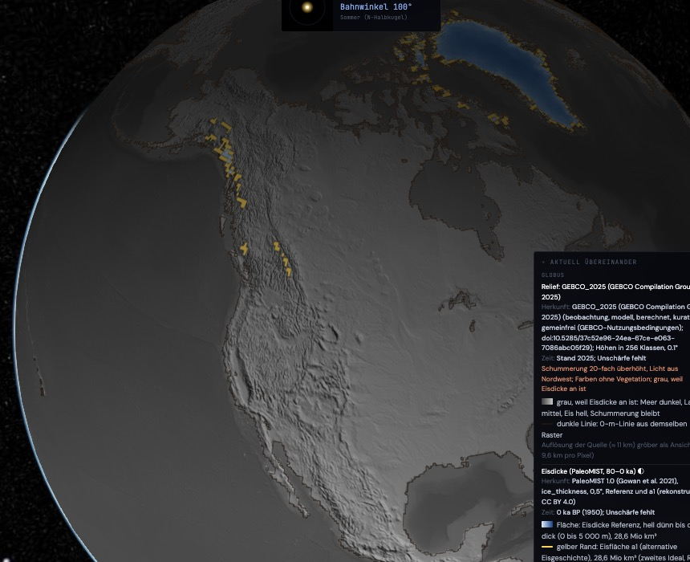
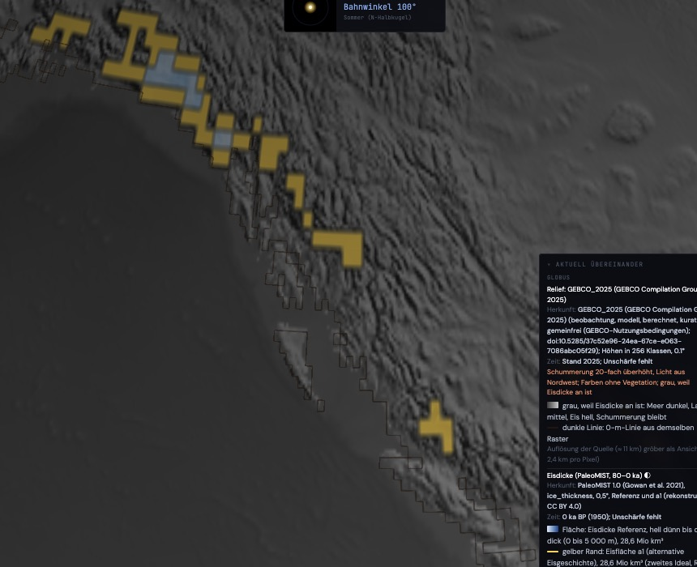
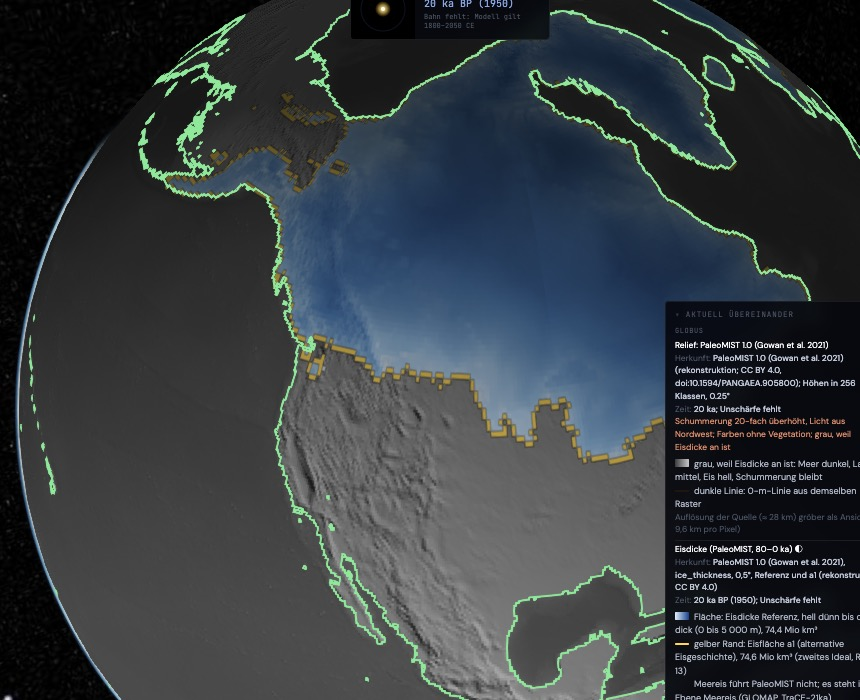
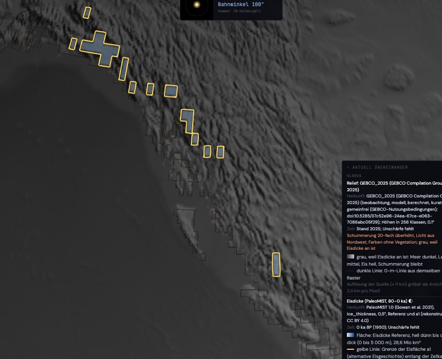
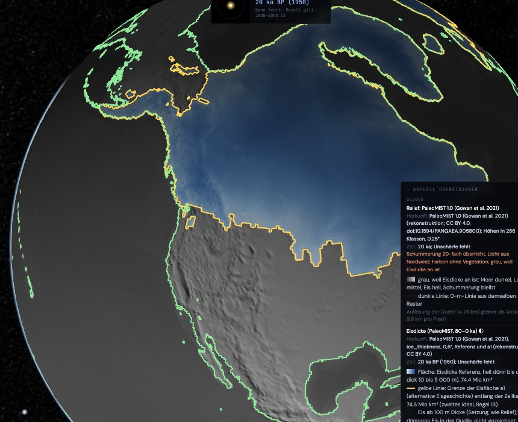
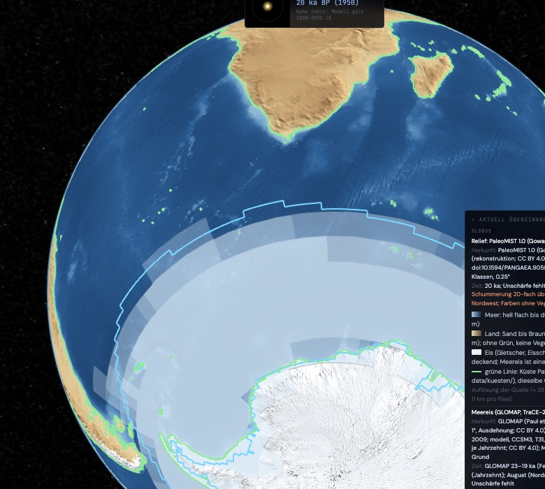

# Bericht: Gelbe Rechtecke in der Eisdicken-Ebene (Untersuchung)

Stand: 2026-11-08. Nur untersucht, nichts geändert. Geprüft an den Daten (`data/eis/`, Quelldatei `~/ZeroEarth/rohdaten/ice_reconstruction/global_grid/reconstruction_0.25_degree.nc`) und im Browser: Chromium ohne Fenster und der Browser der Claude-App.

## Ergebnis in einem Satz

Die Rechtecke sind **kein Datenfehler und keine Musterfüllung**, sondern der **Rand des zweiten Ideals (a1)**: Er wird nicht als Linie gezeichnet. Jede Eiszelle, die an eisfreies Gebiet grenzt, wird **ganz gelb** gefärbt, und eine Zelle ist 0,5° groß (rund 55 km). Kleine Gletschergruppen bestehen fast nur aus Randzellen und erscheinen deshalb als massive gelbe Rechtecke.

Verstärkt wird das durch drei Dinge:
- Der Konverter zählt **jede Dicke über 0 m** als Eis, auch 0,04 m.
- Die Füllung dünnen Eises ist auf dem grauen Relief kaum zu sehen.
- Bei 0 ka sind Referenz und a1 gleich, der Rand verdoppelt also nur die Füllung.

## 1. Was zeichnet die Rechtecke?

- **Zeichnende Stelle:** `EisLayer.bild(kl, false)` in `index.html` (Zeilen 6155–6162).
  - Für das zweite Ideal wird jedes Pixel mit `k > 0` gelb (`rgb(255, 214, 90)`, voll deckend), sobald ein Nachbar kein Eis ist.
  - Ein Pixel ist eine Gitterzelle (0,5°).
  - Danach wird das Bild für den Halbzellen-Versatz auf doppelte Größe gezogen, jede Zelle also 2 × 2 Bildpunkte, ohne Glättung.
- **Folge:** Der „Rand“ ist eine Zelle breit, also rund 55 km. Bei großen Eisschilden (20 ka) liegt er als dicker Saum am Rand. Bei kleinen Gletschern ist **jede** Zelle Randzelle; dann sieht man nur gelbe Blöcke.
- **Keine Musterfüllung:** Die Idealschicht-Bildsprache (schraffiert, leer, halb) ist hier nicht beteiligt; die gelbe Farbe ist fest im Code.
- **Füllung:** Dünnes Eis bekommt das hellste Blau des Verlaufs, mit Deckkraft 225/255. Auf dem grauen Relief (Grau-Modus, weil Eisdicke an ist) ist sie kaum vom Untergrund zu unterscheiden. Sichtbar bleibt der gelbe Rand.

## 2. Aktiver Zeitschritt und Werte

- **Zustand beim Start:** Die Seite startet in der Jahr-Zeile (t = 26, also 2026 CE). Das Grundbild ist dann GEBCO 2025, darum sind die Großen Seen in heutiger Form zu sehen.
- **Gewählter Schritt:** Die Eisdicke rechnet daraus −0,076 ka und wählt den nächsten Schritt im Abstand von höchstens 1,25 ka: **0 ka** (Schritt 0).
  - Status: „PaleoMIST Referenz: 0 ka · 28,6 Mio km³“.
  - Beide Ideale haben bei 0 ka dasselbe Volumen (28 586 359 km³) und dieselben 28 243 Eiszellen.

**Stichproben** (Klasse im PNG und Dicke in der Quelle bei 0 ka):

| Ort | Klasse (Referenz und a1) | Dicke in der Quelle |
| --- | --- | --- |
| Pazifik 45° N, 130° W | 0 | 0 m |
| Utah 40° N, 112° W | 0 | 0 m |
| Hudson Bay 60° N, 85° W | 0 | 0 m |
| zum Vergleich: Alaska-Küste 60° N, 140° W | > 0 | 159,7 m |
| zum Vergleich: Coast Mountains 51° N, 125,5° W | – | 0,04 m |

- **Über alle 33 Schritte:** An Pazifik und Utah steht **in keinem Schritt** Eis. Hudson Bay ist von 10 bis 65 ka vereist.
- **Im Westen der USA** (30–50° N, 125–104° W) gibt es bei 0 ka genau **eine** Eiszelle (50° N, 116,5° W, 123 m).
- **Wo die Rechtecke tatsächlich liegen** (Bildschirmfotos): Alaska-Küste, Coast Mountains in British Columbia, Rocky Mountains um 49–50° N, kanadisch-arktischer Archipel. Das sind die Gletscher, die PaleoMIST bei 0 ka führt.
- **Nicht nachgestellt:** Gleichmäßig verstreute Rechtecke über dem **offenen Pazifik** und **über Utah** sah ich weder in Chromium noch im Browser der App. Die Küstenzellen von Alaska und British Columbia reichen zwar bis an den Pazifik, aber nicht darüber hinaus.
  - Siehst du sie anders, hilft der Link mit Ansicht und Zeit (die Adresszeile nach `#`) oder ein Bildschirmfoto.
  - Im Browser der App las die Seite genau die 28 243 Eiszellen der Datei; ein Rauschen beim Einlesen der PNG-Dateien gibt es also nicht.

## 3. Leerwerte

- **Quelle:** `ice_thickness` hat `_FillValue` und `missing_value` = NaN. Bei 0 ka ist jedoch **kein** Wert maskiert und keiner NaN.
- **Negative Dicken:** Die Quelle enthält sie: 2 793 Zellen bei 0 ka, Minimum −3,44 m. Das Attribut `actual_range` nennt als Minimum −3,06 m, also weniger, als bei 0 ka tatsächlich vorkommt.
- **Konverter** (`matrix-scharnier/adapter/eis.py`):
  - **Maskierte Werte:** werden zu 0 (`np.ma.filled(…, 0.0)`).
  - **Klasse:** `d > 0` ergibt Klasse 1–255, alles andere Klasse 0. Negative Dicken werden also zu „kein Eis“; das ist nicht dokumentiert.
  - **Dünnes Eis:** Jede positive Dicke wird Eis, auch Hundertstel Meter. In Nordamerika (25–72° N) sind bei 0 ka **187 von 562** Eiszellen (0,25°) dünner als 10 m, 385 dünner als 100 m.
- **Uneinheitlich:**
  - Das **Relief** zeigt Eis erst ab 100 m Dicke (Setzung `EIS_AB_M`, im Relief-Bericht begründet).
  - Die **Eisdicken-Ebene** zeigt jede Dicke über 0.
  - Im 0,5°-Gitter der Ebene erfüllen in Nordamerika nur **41 von 147** Eiszellen die 100-m-Schwelle.
  - Dieselbe Zelle ist also im Relief eisfrei und in der Eisdicke gelb umrandet.

## 4. Reihenfolge und Ausrichtung von Breite und Länge

- **Quelle:** Breite −90 … 90 (721 Werte, Süd zuerst), Länge −180 … 180 (1 441 Werte, −180 und 180 doppelt).
- **Konverter:** `[::-1, :-1][::2, ::2]`, also Nord oben, die doppelte Spalte 180 weg, dann jeder zweite Punkt. Ergebnis: 361 Zeilen (90 … −90) und 720 Spalten (−180 … 179,5), je 0,5°.
- **Geprüft:**
  - Dieses Gitter stimmt **Zelle für Zelle** mit den PNG-Dateien überein (Eis genau dort, wo die Dicke über 0 liegt).
  - Grönland (72° N, 40° W) und die Antarktis liegen richtig.
  - Bei 20 ka liegt der Eisschild in der Ebene deckungsgleich mit dem Relief (Bild unten).
- **Seite:** Sie behandelt das Gitter als Punkte (Zellmitten) und versetzt das Bild wie das Relief um eine halbe Zelle. **Die Ausrichtung stimmt.**

## Bildschirmfotos

## Vorschlag zur Behebung (zur Freigabe)

1. **Rand als Linie statt als gefüllte Zelle.**
   - Die Grenze des zweiten Ideals wird als Linie entlang der Zellkanten gezeichnet, wie die Küste (`Kueste.zeichne`, Polylinien), statt Randzellen zu färben.
   - Kleine Gletscher werden dann zu kleinen Umrissen, nicht zu Blöcken.
   - Die Ringe lassen sich mit dem Verfahren aus `kuesten.py` (Kanten zu Ringen) ableiten, im Konverter oder im Browser.
2. **Gleiche Eisschwelle wie im Relief, als Setzung ausgewiesen.**
   - Die Eisdicken-Ebene zeigt Eis wie das Relief ab 100 m. Dünneres Eis bleibt in den Daten, erscheint aber nicht als Fläche.
   - Die Legende sagt: „Eis ab 100 m (Setzung, wie Relief); dünneres Eis in der Quelle, nicht gezeichnet: N Zellen“.
   - **Alternative:** Schwelle 0 m behalten, dann aber dünnes Eis sichtbar füllen statt fast unsichtbar. Das ist deine Entscheidung.
3. **Negative Dicken dokumentieren.**
   - Im Manifest und in `data/eis.json`: „Die Quelle enthält negative Dicken bis −3,4 m (Interpolationsrest); als kein Eis behandelt“, mit Anzahl je Schritt.
   - Nichts weiter ändern: Das ist Ableitung, kein Modell.
4. **Zusammenfallende Ideale kenntlich machen** (Regel 13, „alle zeigen, auch wo sie zusammenfallen“).
   - Wo Referenz und a1 gleich sind (etwa 0 ka), steht in der Legende „a1 fällt hier mit der Referenz zusammen“.
   - Die Linie bleibt, aber sie verdoppelt nicht mehr optisch die Füllung.
5. **Meereis prüfen:** Die Meereis-Ebene zeichnet ihren Rand nach demselben Prinzip, aber auf 0,25°. Wird (1) gebaut, sollte sie dasselbe Linienverfahren bekommen.

Zu entscheiden: Schwelle 100 m (wie Relief) oder 0 m, und ob die Ränder als Linie gebaut werden.

## Stand der Behebung (2026-11-08)

Nach Freigabe („Beides bauen“) umgesetzt; bei der offenen Wahl der Schwelle gilt der erste Vorschlag, 100 m wie im Relief.

1. **Rand als Linie:**
   - Die Grenze des zweiten Ideals wird als Linie entlang der Zellkanten gezeichnet. Dafür dient dieselbe Kantenfunktion wie für die 0-m-Linie des Reliefs (`ReliefLayer._linie`), gelb, 1,6 px.
   - Gefüllte Randzellen gibt es nicht mehr. Kleine Gletscher erscheinen als dünne Umrisse, die Füllung ist darin sichtbar.
2. **Schwelle 100 m:**
   - `eis.py` legt die Klassengrenze exakt auf 100 m: Klasse 37 und höher ist mindestens 100 m dick, Klassen 1–36 darunter. Werte direkt an der Grenze verschieben sich um höchstens eine Klasse.
   - Die Seite füllt und umrandet nur Eis ab der Schwelle. Die Legende sagt: „Eis ab 100 m Dicke (Setzung, wie Relief); dünneres Eis in der Quelle, nicht gezeichnet: N Zellen“. Bei 0 ka sind das 1 274 Zellen.
   - In `data/eis.json` stehen je Schritt `zellen_eis`, `zellen_ab_schwelle` und `eisflaeche_ab_schwelle_km2`.
3. **Negative Dicken:**
   - Sie werden je Schritt gezählt (`negativ_zellen_quelle_025`, `negativ_min_m`), etwa 2 793 Zellen bis −3,44 m bei 0 ka und 2 101 bis −3,82 m bei 20 ka.
   - Sie gelten als kein Eis und zählen **nicht** mehr ins Volumen; vorher wurden sie abgezogen. Das Volumen bei 0 ka steigt dadurch von 28 586 359 auf 28 586 476 km³.
   - Legende und Kern-Manifest nennen das.
4. **Zusammenfallende Ideale:** Wo Referenz und a1 dieselbe Fläche haben (0 ka), sagt die Legende „fällt in diesem Schritt mit der Fläche zusammen“.
5. **Meereis:** Die Grenze der zweiten Quelle (15 %) ist ebenfalls eine Linie (0,25°-Kanten), hellblau.

**Geprüft** in Chromium, ohne Fehler:
- 0 ka über British Columbia: Umrisse statt Blöcke.
- 20 ka: Linie am Eisschild.
- Meereis, 20 ka, August: Linie der GLOMAP-Grenze.
- Kern-Test `eis.test.mjs` ergänzt (Schwelle, negative Dicken); alle 299 Tests grün.

