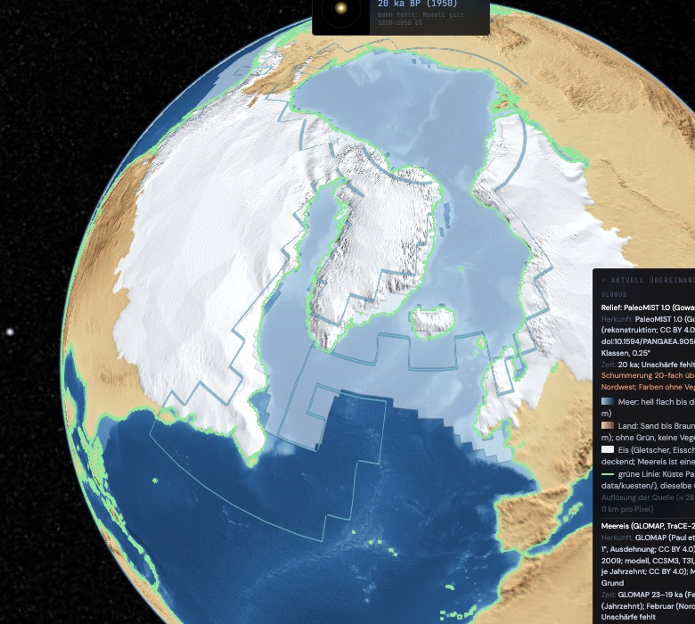
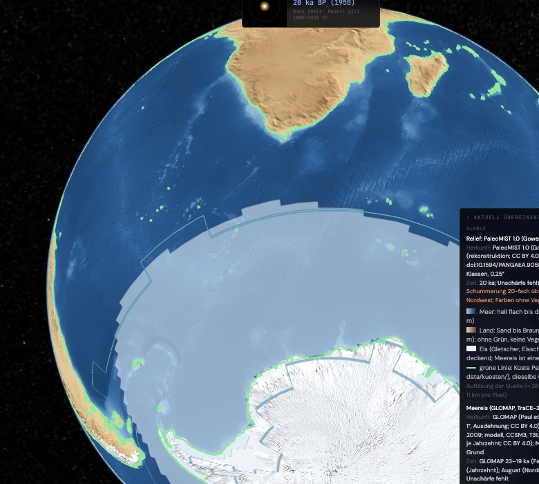
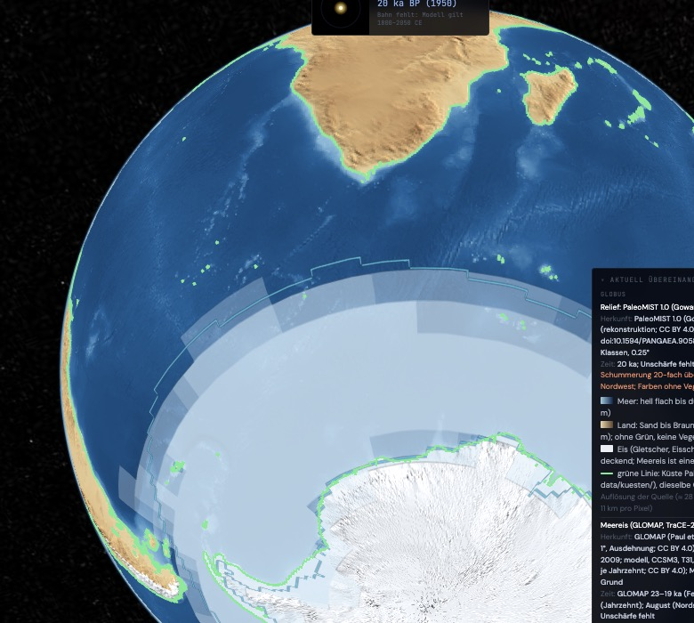
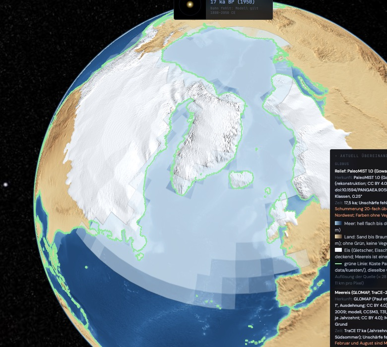

# Bericht: Meereis (Plan)

Stand: 2026-11-06. Plan in Abschnitt 1–7, gebaut am selben Tag (siehe „Stand des Baus“), dazu Abschnitt 8 zu Gebirgsgletschern (nur geprüft). Für den Plan geprüft wurden die Datensatzseiten bei PANGAEA und NCAR GDEX sowie die Kopfdaten der TraCE-Dateien über den Datenserver (OPeNDAP). Zum Zeitpunkt des Plans lag keine der drei Quellen in `~/ZeroEarth/rohdaten/`.

## 1. Die drei Quellen

| | GLOMAP | MARGO 2009 | TraCE-21ka |
| --- | --- | --- | --- |
| **Wer** | Paul, Mulitza, Stein & Werner 2021, Clim. Past 17, 805–824, doi:10.5194/cp-17-805-2021 | MARGO Project Members (Waelbroeck et al.) 2009, Nat. Geosci. 2, 127–132, doi:10.1038/ngeo411 | Liu et al. 2009, Science 325, 310–314; Daten NCAR GDEX d651050, doi:10.5065/CXB5-TV56 |
| **Art** | rekonstruktion (Proxy-Synthese, auf ein Gitter gebracht) | rekonstruktion (Proxy-Synthese) | modell (CCSM3, gekoppelt, transient) |
| **Zeitraum** | eine Zeitscheibe: Letztes Glaziales Maximum, 23–19 ka BP | dieselbe Zeitscheibe, 23–19 ka BP | 22 ka BP bis 1990 CE, 2 204 Jahrzehnte |
| **Auflösung** | 1° × 1° | Kernstandorte; Mittel in 5°-Blöcken | 3,75° (T31) im Atmosphärengitter; das Ozean- und Eisgitter (gx3) ist krummlinig, rund 3° |
| **Meereis als** | Ausdehnung (Eis ja/nein), Grenze für Winter und Sommer | **kein Meereis-Feld** (Abschnitt 2) | Bedeckungsgrad 0–1 (`ICEFRAC`), Jahreszeitenmittel DJF, JJA, MAM, SON je Jahrzehnt; im Eismodell (`aice`) nur Jahresmittel |
| **Jahreszeit** | JFM als Februar, JAS als August; dazwischen eine Sinuskurve der Eisgrenze (Setzung der Autoren) | Oberflächentemperatur für JFM, JAS, Jahr | DJF, JJA (Kalender des Modells, 365 Tage) |
| **Unschärfe** | für die Eisgrenze keine angegeben; Eiszellen tragen −1,8 °C ± 2 °C | je Kern Güte-Flags, keine Eisgrenze | keine; ein einzelner Modelllauf |
| **Lizenz** | CC BY 4.0 (PANGAEA, doi:10.1594/PANGAEA.923262) | CC BY 3.0 (PANGAEA, doi:10.1594/PANGAEA.733406) | CC BY 4.0 (GDEX-Seite) |
| **Datei** | `glomap_v08_nsst_fice.nc`, 29,8 MB | ZIP der Zusatzdaten, 3,9 MB | je Jahreszeit eine Datei mit allen Atmosphärenvariablen, 38 GB; nur `ICEFRAC` daraus abrufbar, je Jahreszeit rund 41 MB |

**Woher die Rekonstruktion kommt (Herkunftskette, laut Paul et al. 2021):**
- **Nordhalbkugel:** de Vernal et al. 2005 und Kucera et al. 2005 (Dinozysten, Labrador- und Nordmeer), Xiao et al. 2015 (Barentssee), Méheust et al. 2018 (Nordpazifik, IP25). Die IP25-Werte gelten für das Frühjahr und werden als Wintergrenze genommen; das Nordmeer gilt im Sommer als eisfrei.
- **Südhalbkugel:** Gersonde et al. 2005 (Diatomeen, Winter und Sommer), Roche et al. 2012 (Sommer).
- Die Grenzen wurden aus veröffentlichten Karten digitalisiert und auf das 1°-Gitter gelegt. Die Kette führt also über Karten, nicht über Kernwerte.

## 2. MARGO 2009 liefert kein Meereis

- Die Zusatzdaten (Tabellen S1–S9, Abbildungen S1–S5) enthalten nur Oberflächentemperaturen je Proxy und 5°-Mittel.
- Meereis kommt im Umfeld von MARGO vor, aber in den Einzelarbeiten von 2005 (Quaternary Science Reviews 24): Gersonde et al. für den Südozean, de Vernal et al. für den Norden. Beide sind über GLOMAP schon in der Kette.
- **Vorschlag:** MARGO nicht als Meereis-Quelle führen, sondern unter „fehlt“ mit diesem Grund. Später möglich: Gersonde 2005 und de Vernal 2005 als Kernpunkte (beobachtet am Kern, rekonstruiert als Eis), damit die Rekonstruktion bis an die Standorte zurück sichtbar wird. Das ist eine eigene Prüfung und ein eigener Download.
- Als Temperatur-Ebene bleibt MARGO ein Kandidat (Paläotemperatur 20 ka).

## 3. Jahreszeit als Wahl

- **Wahl „Februar“ oder „August“.** Ein Bild ist ein Moment im Kalender: Im Februar ist im Norden Winter und im Süden Sommer, im August umgekehrt. Ein Bild mit beiden Wintern zugleich gäbe es nie; das wäre eine Erfindung.
- Die Legende sagt es ausdrücklich: „Februar: Nordwinter, Südsommer“.
- **Die Quellen messen verschieden:**
  - GLOMAP: JFM (als Februar) und JAS (als August).
  - TraCE: DJF und JJA. Für Februar gilt DJF, für August JJA.
  - Die Abweichung um einen Monat steht in der Legende (Regel 16). Umgerechnet wird nichts, auch nicht über die Sinuskurve der GLOMAP-Autoren.
- **Jahresmittel** gibt es nur in TraCE. Als dritte Wahl ist es möglich, für GLOMAP fehlt es dann mit Grund.

## 4. Zeit und Ideale (Regel 13)

- **GLOMAP** gilt nur im Fenster 23–19 ka. Auf der Takt-Leiste erscheint es als Band in der ka-Zeile, nicht als Punkt, weil es ein Zeitfenster ist. Außerhalb steht „fehlt: GLOMAP ist eine einzige Zeitscheibe (LGM)“.
- **TraCE** hat 2 204 Stützstellen, je ein Jahrzehnt. Die Leiste zeigt sie als Abdeckung von 22 ka bis heute; gewählt wird das Jahrzehnt, das die Zeit enthält. Es ist eine Stützstelle der Quelle, nichts dazwischen.
- **Beide zugleich** zwischen 22 und 19 ka:
  - Eine Quelle füllt, die andere zeigt nur ihre Grenze (wie Eisdicke Referenz und a1).
  - Vorgabe: GLOMAP füllt, TraCE zeigt die 15-%-Grenze (Setzung: die übliche Schwelle für „Meereis vorhanden“, als Setzung beschriftet). Ein Schalter tauscht.
  - Nach Regel 16 ist Gleichzeitigkeit nicht prüfbar: GLOMAP ist ein 4-ka-Fenster ohne Unschärfe, TraCE ein Jahrzehnt eines Modelllaufs.
- **Nach 19 ka** zeigt nur das Modell Meereis. Die Herkunft lautet dann allein `modell`; das ist das Unsicherste (Regel 6) und steht in der Legende vorne.
- **Vor 22 ka** fehlt Meereis mit Grund: PaleoMIST führt kein Meereis, TraCE beginnt bei 22 ka.

## 5. Aussehen

- **Gletscher und Eisschilde** (Relief, PaleoMIST ab 100 m): deckend weiß, mit Schummerung der Eisoberfläche (so gebaut).
- **Meereis:** flach, ohne Schummerung, bläulich-weiß (etwa `rgb(214, 232, 245)`), halbtransparent, sodass die Tiefe des Meeres durchscheint.
  - TraCE: Deckkraft nach Bedeckungsgrad in fünf Stufen (15, 30, 50, 70, 90 %), keine stufenlose Glättung.
  - GLOMAP: eine Stufe, weil die Quelle nur ja/nein kennt.
  - Getrennt wird Meereis vom Gletscher über Füllung und Helligkeit, nicht über die Linienart.
- **Zellen:** Jede Zelle wird als Fläche ihres Gitters gezeichnet, ohne Weichzeichnen.
  - TraCE: 3,75° (Atmosphärengitter, so in der Datei).
  - GLOMAP: 1°.
  - Die Legende nennt die Auflösung, wie beim Relief.
- **Grau-Modus:** Meereis ist eine Fläche, keine Feld-Skala. Das Relief bleibt farbig; ist eine Feld-Ebene an, bleibt das Meereis trotzdem sichtbar.
- **Küste:** Die Landmaske von TraCE (ICE-5G) und von GLOMAP (GLAC-1D, 21 ka) sind nicht die von PaleoMIST. Meereis kann darum über PaleoMIST-Land oder vor der grünen Küste enden. Nichts wird beschnitten; die Legende nennt die Landmaske je Quelle.

## 6. Bau (nach Freigabe)

**Laden** nach `~/ZeroEarth/rohdaten/meereis/`, nicht ins Repo:
1. GLOMAP `glomap_v08_nsst_fice.nc`, 29,8 MB, von PANGAEA (doi:10.1594/PANGAEA.923262). Ob `fice` zwölf Monate oder nur die beiden Masken führt, ist erst nach dem Laden prüfbar. Bei zwölf Monaten nehme ich nur Februar und August, die Monate der Quelle, und rechne nichts aus der Sinuskurve nach.
2. TraCE-21ka `ICEFRAC` aus `b30.00_4kaDVTd.cam2.ncrcat.djf.nc` und `…jja.nc`, nur diese Variable mit `lat`, `lon`, `time`, über den OPeNDAP-Dienst von NCAR GDEX. Je Jahreszeit rund 41 MB, zusammen rund 82 MB. Die ganzen Dateien (je 38 GB) werden nicht geladen.
3. MARGO wird nicht geladen (Abschnitt 2).

**Ableiten** (`matrix-scharnier/adapter/meereis.py`), in `data/meereis.json` und `data/meereis/`:
- **GLOMAP:** zwei 1-bit-Masken (Februar, August) als PNG, 360 × 180, je wenige KB.
- **TraCE:** je Jahreszeit ein Atlas-PNG, 2 204 Jahrzehnte × 96 × 48 Zellen, Bedeckung in 8-bit-Klassen. Geschätzt 1–3 MB je Jahreszeit; einzeln nachladbar, falls größer.
- **Abgeleitete Größen je Schritt:** Meereisfläche Nord und Süd in km² (`berechnet`).

**Kern:**
- Adapter `kern/adapter/meereis/`: Stapel 1.1, `sphaere: "kryosphaere"`, Vorgang Stoffwechsel.
- Einträge je Quelle mit Herkunft (GLOMAP: rekonstruktion; TraCE: modell; Flächen: berechnet).
- `fehlt` für MARGO, für die Zeit vor 22 ka, für GLOMAP außerhalb 23–19 ka.
- Die Eisdicke-Ebene bekommt ebenfalls `sphaere: "kryosphaere"`.
- Tests wie bei `eis`.

**Seite:**
- Ebene „Meereis“ unter Kryosphäre mit der Wahl Februar/August und dem Tausch der Füllung.
- Stützstellen auf der Takt-Leiste.
- Legende mit Herkunft, Landmaske und Monatsabweichung.
- Die Sintflut-Station „Eis → Ozean“ schaltet Meereis mit ein.
- Der bisherige Text „Packeis fehlt in allen Quellen“ in Relief und Legende wird ersetzt.

## 7. Offen

- **Jahresmittel als dritte Wahl?** Nur TraCE hat es.
- **Kernpunkte Gersonde 2005 und de Vernal 2005:** jetzt oder später?
- **Die 15-%-Schwelle** für die TraCE-Grenze ist eine Setzung. Alternativ zeigt der Rand jede Klasse als eigene Linie; das wäre unruhiger.

## Stand des Baus (2026-11-06)

**Geladen** nach `~/ZeroEarth/rohdaten/meereis/` (nicht im Repo):
- **GLOMAP:** `glomap_v08_nsst_fice.nc`, 31 MB.
- **TraCE-21ka:** `ICEFRAC` für DJF und JJA.
  - **Abruf:** Der Teilabruf über NCSS bricht bei diesen Dateien mit einem Fehler des Servers ab. Darum lädt `matrix-scharnier/adapter/trace_icefrac_holen.py` über OPeNDAP in Stücken, mit Pausen bei 503/504, und setzt sie zu `trace_icefrac_djf.nc` und `trace_icefrac_jja.nc` zusammen.
  - **Stand:** Geladen ist 22 bis 16,5 ka (551 Jahrzehnte je Jahreszeit). Danach antwortete NCAR am 2026-11-06 nachmittags auf jeden Abruf mit 503/504, zuletzt auch der Katalog.
  - **Entscheidung von Max:** Der Nachlader ist gestoppt, NCAR wird nicht weiter angefragt. Genutzt werden die Teildaten. TraCE von 16,49 ka bis heute fehlt mit dem Grund „Server nicht erreichbar, Abruf ausstehend“ (in `data/meereis.json` unter `quellen.trace.rest`, im Kern als `trace_rest`, auf der Seite im Status).
  - **Ein einziger neuer Versuch** erst in einigen Tagen: `python3 trace_icefrac_holen.py`. Vorhandene Stücke bleiben liegen; danach `meereis.py` neu laufen lassen und im Manifest die Abdeckung (22–16,5 ka, 551 Schritte) auf 22–0 ka, 2 204 Schritte setzen.
  - **Teildaten ohne Abruf zusammensetzen:** `trace_icefrac_holen.py --ohne-abruf` schreibt den Rest als fehlend in die Datei (`fehlt_grund`, `fehlt_ab_index`).

**GLOMAP geprüft:**
- **Monate:** `fice_lgm` hat 12 Monate (eine Sinuskurve der Autoren zwischen Winter- und Sommergrenze). Genommen werden nur Februar und August.
- **Kodierung:** 1 = offen, 2 = Eis, obwohl `long_name` „0–1“ sagt. Gelesen nach der Lage, gegen den Artikel geprüft: Das Nordmeer ist im August eisfrei, der Südozean im August bis rund 50° S vereist.
- **Flächen:**
  - Februar: Nord 17,1, Süd 13,8 Mio km²
  - August: Nord 6,0, Süd 37,6 Mio km²

**Gebaut:**
- **`matrix-scharnier/adapter/meereis.py`:**
  - GLOMAP: zwei Masken (1°)
  - TraCE: je Jahreszeit ein Atlas (je Jahrzehnt eine Kachel 96 × 48, Bedeckung in 201 Klassen)
  - Flächen Nord und Süd je Schritt
  - Ausgabe `data/meereis.json` und `data/meereis/`
- **Kern:** Adapter `kern/adapter/meereis/`.
  - Stapel 1.1, `sphaere: "kryosphaere"`; die Eisdicke trägt jetzt ebenfalls die Kryosphäre.
  - Ideale GLOMAP und TraCE (Regel 13).
  - TraCE-Werte tragen `modell` + `berechnet`, nicht `idealisiert`.
    - `idealisiert` gilt nur für Referenz- und Gleichgewichtszustände (Strukturstand).
    - TraCE ist ein transienter Lauf, also physikalisch abgeleitet: `berechnet` im Sinne von `kern/schema.mjs`.
    - Regel 6 verlangt an einem Modellwert eines der beiden Merkmale.
    - Ein Test prüft, dass `idealisiert` im Graphen nicht vorkommt.
  - MARGO als Eintrag `fehlt` mit Grund.
  - Test `kern/test/meereis.test.mjs`.
- **Seite:** Ebene „Meereis“ unter Erdsystem.
  - Wahl Februar/August; Tausch, welche Quelle füllt.
  - Stützstellen: TraCE je Jahrzehnt als Punkte in der ka-Zeile, GLOMAP als Band 23–19 ka.
  - Legende mit Monat der Quelle, Landmasken und MARGO.
  - Die Sintflut-Station „Eis → Ozean“ schaltet Meereis mit ein.
  - Die Texte „Packeis fehlt“ in Relief und Eisdicke sind ersetzt.
- **Aussehen:**
  - Meereis flach `rgb(214, 232, 245)`.
  - GLOMAP mit Deckkraft 0,62.
  - TraCE in fünf Stufen ab 15 % (0,30 bis 0,82).
  - Rand der zweiten Quelle hellblau `rgb(120, 214, 255)`.
  - Gletscher bleiben deckend weiß mit Schummerung.

**Geprüft im Browser** (Chromium, Teildaten), ohne Fehler auf der Konsole:
- **20 ka Februar, Nordatlantik:** GLOMAP füllt, TraCE als Rand. Die TraCE-Grenze reicht weiter nach Süden als GLOMAP.
- **20 ka August, Südozean:** beide Quellen, dann TraCE füllend. Das Südeis ist fast gleich groß: GLOMAP 37,6, TraCE 36,9 Mio km².
- **17 ka Februar:** nur TraCE, die Legende sagt „Nur das Modell“. Das Nordeis ist im Modell größer als bei 20 ka (26,4 statt 18,1 Mio km²). Eine Deutung (etwa als Folge eines bestimmten Ereignisses) steht nicht auf der Seite, weil keine Quelle dafür eingebunden ist.

**Was auffällt:**
- Die Zellen von TraCE (3,75°) liegen teils über PaleoMIST-Land und über Gletschern, weil die Landmaske eine andere ist (ICE-5G). Nach Plan wird nichts beschnitten.
- Über Gletschern tönt das halbtransparente Meereis das Weiß leicht bläulich.

## 8. Gebirgsgletscher (geprüft, nicht gebaut)

**Was fehlt.**
- PaleoMIST führt die großen Eisschilde. Gebirgsgletscher, die kleiner sind als eine Rasterzelle (0,25°, rund 28 km), fehlen; ebenso Eiskappen unterhalb der Zellgröße.
- Heute zeigt das Relief (GEBCO) überhaupt kein Eis.

**Heute: Randolph Glacier Inventory 7.0 (RGI 7.0).**
- **Wer:** RGI 7.0 Consortium 2023, NSIDC-0770, doi:10.5067/F6JMOVY5NAVZ.
- **Inhalt:** Umrisse aller Gletscher größer als 0,01 km², 274 531 Gletscher mit zusammen 706 744 km² (Benutzeranleitung v1.0, Zenodo 8362857).
- **Ohne die Eisschilde:** Grönlands Eisschild und das antarktische Festland sind ausgenommen, ihre Randgletscher sind enthalten.
- **Gliederung:** 19 Regionen mit Gletschern (dazu Region 20, Antarktisches Festland, ohne Einträge), 90 Unterregionen. Tibet liegt in den Regionen 13–15 (Hochasien).
- **Zeitbezug:** Zielzeit um 2000, in manchen Regionen mit großer Spanne. Die Quelle sagt selbst, dass sie nicht für Flächenänderungen einzelner Gletscher taugt.
- **Format:** Shapefiles je Region und global, dazu CSV (Hypsometrie, Attribute). Produkte: Gletscher (G), Gletscherkomplexe (C), Berührungslinien (I), Mittellinien (L). WGS 84.
- **Lizenz:** nicht einheitlich angegeben.
  - Die Anleitung nennt für die Umrisse die Lizenzvereinbarung von GLIMS.
  - rgidata.org zeigt CC BY 4.0 in der Fußzeile.
  - Der NASA-Katalog führt „U.S. Government Works“.
  - NSIDC macht das Zitat zur Bedingung.
  - Vor der Nutzung zu bestätigen; die Anleitung selbst steht unter CC BY 4.0.
- **Laden:** nur mit NASA-Earthdata-Konto (die Dateiliste leitet auf die Anmeldung um). Ein Konto lege ich nicht an. Du müsstest die Dateien laden, nach `~/ZeroEarth/rohdaten/rgi7/`.
- **Größe:** Auf den Seiten nicht angegeben. Die globale Shapefile-Fassung dürfte einige hundert MB haben; das ist nicht gemessen.
- **Herkunft je Umriss:** `beobachtung` (Satellitenbilder, Kartierung) mit `kuratiert` (Auswahl durch das Konsortium).

**Eiszeit: Ehlers, Gibbard & Hughes 2011.**
- **Wer:** Ehlers, J., Gibbard, P. L. & Hughes, P. D. (Hrsg.) 2011, Quaternary Glaciations – Extent and Chronology: A Closer Look, Developments in Quaternary Science 15, Elsevier.
- **Digitale Karten:**
  - Die Begleitseite von Elsevier (booksite.elsevier.com/9780444534477) ist abgeschaltet („Decommissioned Site“).
  - Die Kopie in der CRC-806-Datenbank der Universität Köln ist laut eigener Seite offline.
  - Erreichbar ist noch `static.us.elsevierhealth.com/ehlers_digital_maps/digital_maps_02_all_other_files.zip`: 35,8 MB, zuletzt geändert 2020, mit `lgm.shp` und `lgm_alpen.shp`. Diesen Weg nutzt auch das Python-Paket hyoga (GPL), das die Datei mit dem Zusatz „braucht Bereinigung (Dubletten)“ liest.
  - Nicht geladen, nur die Kopfdaten geprüft.
- **Lizenz:** nirgends angegeben, weder auf der Datei noch im Buch-Umfeld. Damit nicht frei verwendbar, bis Elsevier oder die Herausgeber es klären (Regel: Lizenz geprüft vor Einbau).
- **Format:** ESRI-Shapefiles, Polygone der Vereisung; dazu KMZ für Google Earth (nur Bilder).
- **Zeitbezug:**
  - „LGM“ als Zeitscheibe, regional benannt (Weichsel, Devensian, Wisconsinan; MIS 2), ohne Kalenderalter und ohne Unschärfe.
  - Das lokale Maximum liegt in vielen Gebirgen nicht gleichzeitig: Owen & Dortch 2014 (Quaternary Science Reviews 88, 14–54) finden in den trockenen Teilen von Himalaya und Tibet die größte Ausdehnung früh im letzten Glazialzyklus und kleinere Vorstöße im globalen LGM.
  - Nach Regel 16 ist die Karte darum ein Fenster ohne geprüfte Gleichzeitigkeit, kein Zeitpunkt.
- **Herkunft:** `rekonstruktion` (Moränen, Datierungen) mit `kuratiert` (Zusammenstellung der Herausgeber).
- **Alternative mit Lizenz:**
  - Batchelor et al. 2019 (Nature Communications 10, 3713; Artikel CC BY 4.0) bieten Shapefiles bei OSF (osf.io/7jen3).
  - Sie zeigen aber nur Eisschilde größer als 50 000 km² und nur die Nordhalbkugel. Ihr LGM (rund 26,5 ka) ist weitgehend aus Ehlers 2011 übernommen.
  - Eine Lizenz für die OSF-Dateien nennt die OSF-Seite nicht.
  - Für Gebirgsgletscher hilft das nicht.

**Hinweis Tibet.**
- **Streit um das Ausmaß:** Wie weit Tibet vereist war, ist seit Jahrzehnten umstritten.
  - Kuhle vertrat einen geschlossenen Eisschild von rund 2,4 Mio km² über dem Plateau im LGM.
  - Die meisten Feldstudien seit Shi, Zheng & Li 1992 finden dafür keine Belege. Sie sprechen für ausgedehnte Gebirgsgletscher und Eiskappen.
  - Owen & Dortch 2014 fassen zusammen: Die größte Ausdehnung lag in den trockenen Gebieten früh im Zyklus, nicht im LGM.
- **Was die Karten sagen:** Auch Ehlers & Gibbard kennzeichnen Tibet (und Sibirien) als Gebiet strittiger Deutung (Universität Cambridge, Quaternary Group).
- **Folge für die Anzeige:** Ein Tibet-Umriss stünde nie allein. Er bekäme den Hinweis „Ausmaß umstritten“ mit beiden Positionen und Quellen (Regel 13: konkurrierende Ideale zeigen). Wo nur eine Position als Umriss vorliegt, fehlt die andere mit Grund.

**Darstellung (Vorschlag):**
- Gleiche Optik wie der Eisschild: deckend weiß. Wo keine Höhe vorliegt (Umriss ohne Relief), ohne eigene Schummerung; die Schummerung kommt dann aus dem Relief darunter.
- **Kleine Gletscher:** Bis zu einer Größe von einigen Bildpunkten als Umriss, größere als Fläche. Gesetzt wird eine Schwelle in km² je Zoomstufe (Setzung, in der Legende).
- **Getrennt vom Meereis:** über Deckkraft (deckend gegen durchscheinend) und Helligkeit, wie bei den Eisschilden.
- **Getrennt von PaleoMIST:** über die Legende (Quelle je Fläche), nicht über die Optik. Wo beide Eis zeigen, steht die Gleichzeitigkeit wie überall unter Regel 16.

**Offen:**
- Lizenz und Laden von RGI 7.0: Earthdata-Konto, Lizenz bestätigen.
- Lizenz der Ehlers-Karten klären oder eine andere Paläo-Gletscherquelle mit Lizenz suchen.
- Vor dem Bau ein Plan zur Größe: RGI hat 274 531 Umrisse. Nötig wären eine vereinfachte, gekachelte Fassung und ein Größenziel.
