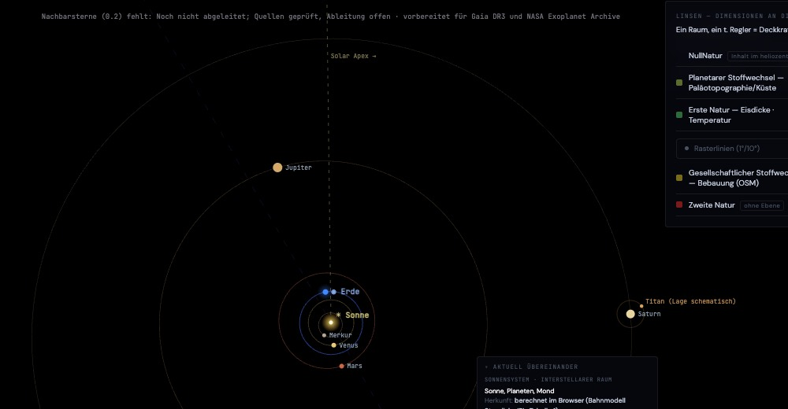
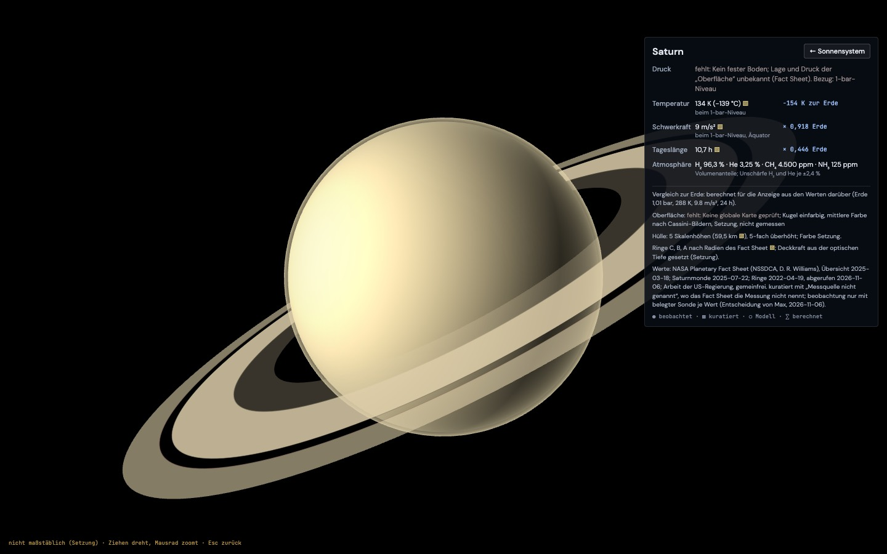
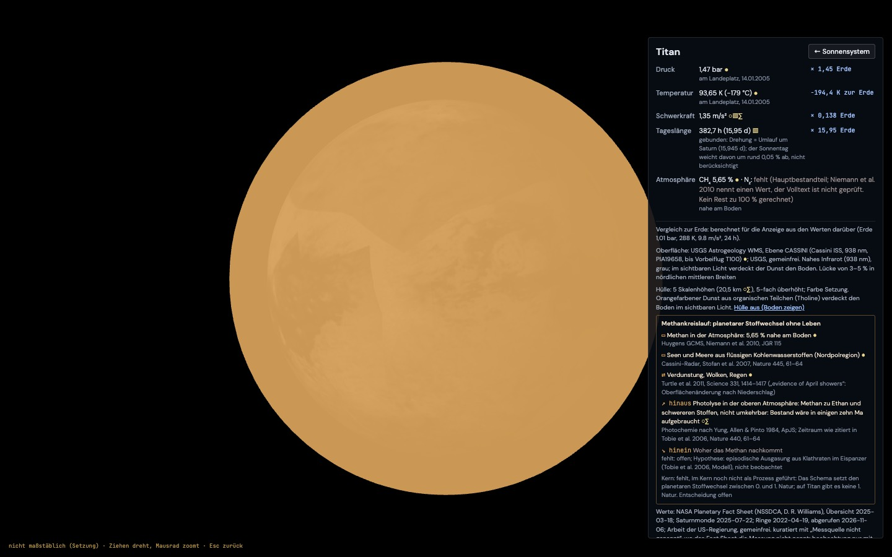
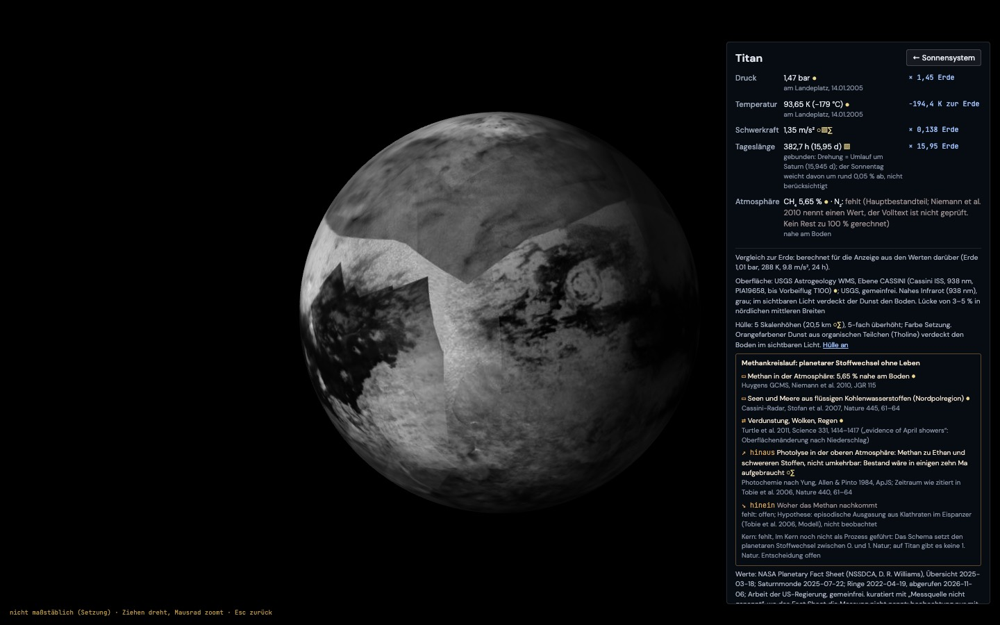
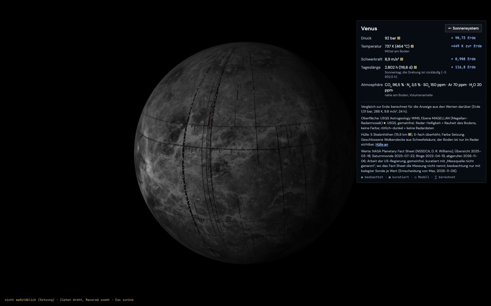
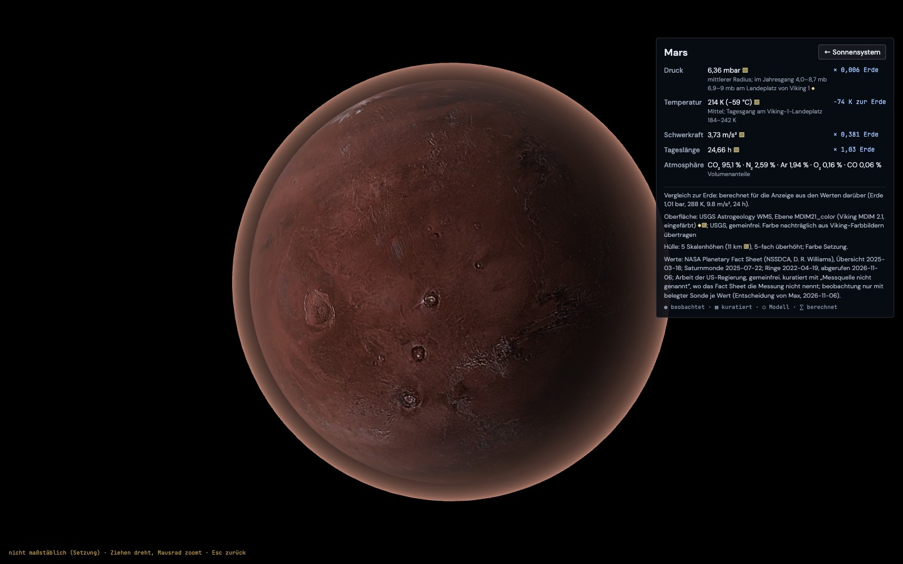
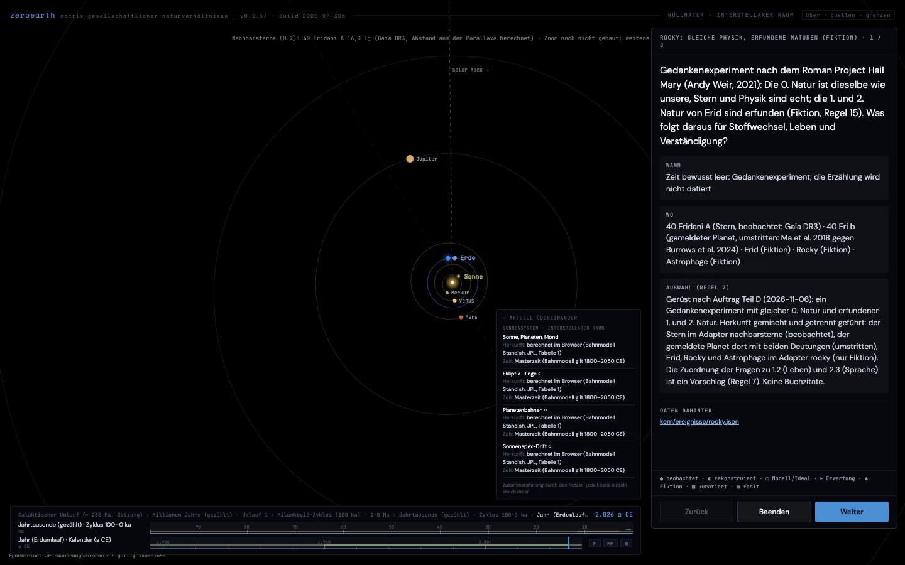

# Bericht: Planetenansicht (Plan)

Stand: 2026-11-06. Nur Plan, gebaut wird nach deiner Freigabe (Abschnitt 8). Geprüft wurden die Seiten der Quellen; heruntergeladen ist nichts.

## 1. Ausgangslage

- **Bisherige Ansicht:** Die Sonnensystemansicht ist eine 2D-Zeichnung (`SolarSystem2D` in `index.html`, Canvas `#ss-canvas`), Draufsicht auf die Ekliptik.
  - Bahnen nach Standish (JPL, Tabelle 1), gültig 1800–2050; außerhalb fehlen die Planeten mit Grund.
  - Das Mausrad führt stufenlos: solar → interstellar → kosmologisch, nach innen zur Erde (Cesium).
- **Was fehlt:**
  - Kein Körper ist anklickbar.
  - Titan kommt nicht vor.
  - Es gibt keine Kugelansicht außer der Erde.

## 2. Was gebaut werden soll

1. **Anklicken:** Die acht Planeten und Titan werden in der Sonnensystemansicht anklickbar; Titan erscheint dort als Punkt bei Saturn.
2. **Hinflug:** Die 2D-Ansicht zoomt auf den Körper und blendet in eine Kugelansicht über.
3. **Kugelansicht:** Kugel mit Oberfläche, darüber eine Atmosphärenhülle. Ziehen dreht die Kugel, das Mausrad zoomt; zurück führt in die Sonnensystemansicht.
4. **Feld je Körper:** Druck, Temperatur, Atmosphärenzusammensetzung, Schwerkraft, Tageslänge.
   - Jeder Wert steht im Vergleich zur Erde (Faktor).
   - Jeder Wert trägt seine Herkunft (Abschnitt 4).
5. **Titan:** Der Methankreislauf als planetarer Stoffwechsel ohne Leben (Abschnitt 6).
6. **Hinweis im Bild:** „nicht maßstäblich (Setzung)“, wo Größe oder Abstand nicht maßstäblich sind: Planetengröße in der Draufsicht, Dicke der Atmosphärenhülle, Titans Abstand zu Saturn.
7. **Vorbereitet, nicht gebaut:** der Zoom zu den Nachbarsternen (0.2, interstellarer Raum), siehe Abschnitt 7.

## 3. Technik der Kugelansicht (Vorschlag)

**A (empfohlen): eigene kleine WebGL-Szene mit three.js.**
- **Einbindung:** `three@0.149.0` (letzte Fassung mit `build/three.min.js`, rund 600 KB) von jsDelivr, wie die übrigen Bibliotheken.
- **Szene:**
  - Eine Kugel mit Textur in einfacher Länge-Breite-Abbildung.
  - Licht aus Richtung Sonne, aus den Bahnen berechnet; außerhalb 1800–2050 als Setzung von links.
  - Eine zweite, etwas größere Kugel als Hülle, mit einem Shader, der zum Rand hin dichter wird.
- **Für A spricht:**
  - Die Atmosphäre ist frei einstellbar: Farbe, Dicke, Deckkraft je Körper.
  - Die Venus kann eine undurchsichtige Wolkendecke tragen, die man abschalten kann (Radar darunter).
  - Saturn bekommt Ringe als Scheibe.
- **Dagegen:** eine weitere Bibliothek.

**B: zweiter Cesium-Viewer mit anderem Ellipsoid.**
- **Dafür:** Cesium kennt eigene Ellipsoide (Mond, Mars), und Bildkacheln wie auf der Erde wären möglich.
- **Dagegen:**
  - Die Atmosphäre von Cesium ist auf die Erde abgestimmt; Venus, Titan und die Gasplaneten wären kaum darstellbar.
  - Ein zweiter Viewer kostet viel Speicher.

**Hinflug:**
- In 2D wächst der Maßstab über rund 1,5 s auf den Körper.
- Danach blendet die WebGL-Szene ein, Kamera zuerst weit, dann auf zwei Kugeldurchmesser.
- Kein echter 3D-Flug durch das Sonnensystem; das stünde als „Übergang, nicht maßstäblich (Setzung)“ im Bild.

**Atmosphärenhülle (Setzung, beschriftet):**
- **Dicke:** Gezeichnet werden 5 Skalenhöhen. Weil die Hülle bei Mars sonst nicht sichtbar wäre, ist die Dicke um einen festen Faktor überhöht, wie die Schummerung beim Relief. Faktor und Skalenhöhe stehen in der Legende.
- **Farbe:** einfache Setzung je Körper (Erde blau, Mars rötlich, Venus gelblich, Titan orange), als Setzung beschriftet, nicht als Messung.
- **Merkur:** Er hat keine nennenswerte Atmosphäre, nur eine Exosphäre. Keine Hülle; im Feld „Exosphäre, Druck nahe null“ mit Quelle.

## 4. Werte und Herkunft

**Quelle der Grundwerte:** NASA Planetary Fact Sheet (NSSDCA, D. R. Williams).
- **Stand:** Übersicht 2025-03-18; Saturnmonde 2025-07-22.
- **Lizenz:** Arbeit der US-Regierung, gemeinfrei.
- **Gebrauch:** Die Tabellen werden einmal abgeschrieben, nach `kern/daten/planeten.json`, mit Abrufdatum.

**Herkunft je Wert.**
- **Das Fact Sheet ist eine Zusammenstellung:** Jeder Wert trägt `kuratiert`.
- **Dazu die Art der Bestimmung, nur wo belegt:**
  - `beobachtung`: von einer Sonde gemessen, im Ort oder aus der Bahn. Beispiele: Druck am Boden von Venus (Venera, Pioneer Venus), Mars (Viking, Curiosity) und Titan (Huygens); Zusammensetzung aus Massenspektrometern (Viking, Galileo-Sonde, Huygens).
  - `berechnet`: aus anderen Werten abgeleitet, etwa die Schwerkraft aus GM/r², die Skalenhöhe, die Faktoren zur Erde.
  - `fehlt` mit Grund, wo das Fact Sheet die Messung nicht nennt. Laut Abruf trifft das für die meisten Zeilen zu: Die Mars-Seite nennt Viking nur für den Druckbereich und die Tagesgänge. Bis eine Messquelle je Wert gefunden ist, steht dort „Messquelle nicht genannt“. Die Herkunft ist dann allein `kuratiert`, und es wird nicht geraten.
- **Gasplaneten:**
  - **Druck:** Bodendruck „Unknown*“ im Fact Sheet. Bei uns `fehlt` mit Grund „kein fester Boden“. Angezeigt werden Temperatur und Zusammensetzung beim 1-bar-Niveau, als Bezugsfläche benannt.
  - **Herkunft der Zusammensetzung:** Bei Jupiter ist sie gemessen (Galileo-Sonde 1995, `beobachtung`). Bei Saturn, Uranus und Neptun kommt sie aus Fernerkundung und Modellen; Art je Wert prüfen.
- **Titan:**
  - Das Fact Sheet hat nur Masse, Radius, Dichte und Bahn. Die Schwerkraft wird daraus berechnet.
  - Atmosphärenwerte kommen von der Huygens-Sonde (14.01.2005):
    - Druck am Boden 1 467 hPa und Temperatur 93,65 K: HASI, Fulchignoni et al. 2005, Nature 438.
    - Zusammensetzung: N₂ rund 95 %, CH₄ 5,65 % am Boden: GCMS, Niemann et al. 2010, JGR 115.
    - Alle mit Herkunft `beobachtung`. Die Zahlen werden beim Bau an den Artikeln geprüft; bis dahin gelten sie als Plan.
- **Tageslänge:** Sonnentag aus dem Fact Sheet. Venus hat einen rückläufigen Sonnentag von 2 802 h. Titan ist gebunden, sein Tag ist der Umlauf um Saturn, 15,95 Tage.
- **Vergleich zur Erde:** Faktor (×) für Druck, Schwerkraft, Tageslänge; Differenz in K für die Temperatur, weil ein Faktor auf °C nichts bedeutet. Die Faktoren tragen `berechnet`.
- **Zeit:** Alle Werte gelten heute (Messzeitraum der Sonden). Bezugssystem `a CE`; Unschärfe je Wert, wo die Quelle sie nennt (Mars-Druck 4,0–8,7 mb im Jahresgang), sonst `fehlt`.

## 5. Oberflächen (Texturen) und Lizenz

**Vorrang:** gemeinfreie Mosaike von USGS und NASA aus Sondenbildern (Herkunft `beobachtung`, bearbeitet). Wo es keine globale Karte gibt, fehlt die Oberfläche mit Grund: Die Kugel ist einfarbig mit der mittleren Farbe aus Sondenbildern, als Setzung beschriftet.

| Körper | Vorschlag | Herkunft | Lizenz | Zu prüfen |
| --- | --- | --- | --- | --- |
| Merkur | MESSENGER MDIS Global Mosaic (USGS Astropedia) | beobachtung | US-Regierung, gemeinfrei | Größe: die 250-m-Fassung hat rund 2 GB; verkleinern auf 2 048 × 1 024 |
| Venus | Wolken: einfarbig (Setzung). Boden: Magellan-Radarmosaik (USGS) | beobachtung (Radar, Falschfarbe) | gemeinfrei | Radarhelligkeit ist keine Farbe; Legende |
| Erde | wie bisher (Cesium) | – | – | Klick auf die Erde führt zur Erde |
| Mars | Viking MDIM 2.1 oder Viking-Farbmosaik (USGS) | beobachtung | gemeinfrei | Farbfassung und Größe |
| Jupiter | Cassini-Karte (NASA/JPL Photojournal, PIA-Nummer) | beobachtung (Dezember 2000) | NASA, gemeinfrei, Vermerk „NASA/JPL-Caltech“ | PIA-Nummer und Auflösung; die Wolken sind ein Moment, kein Dauerzustand |
| Saturn | Cassini-Karte, falls global vorhanden; sonst einfarbig | beobachtung oder fehlt | gemeinfrei | Karte suchen |
| Uranus, Neptun | einfarbig (Voyager 2) | Oberfläche fehlt; Farbe Setzung | – | – |
| Titan | Cassini-ISS-Mosaik 938 nm (USGS) | beobachtung (nahes Infrarot, grau) | gemeinfrei | Download und Größe; die Oberfläche ist nur im Infrarot sichtbar, darüber die orange Dunsthülle |

**Solar System Scope (CC BY 4.0) nur als Rückfall.** Die Seite sagt selbst, dass ungekartete Gebiete mit erfundenem Gelände gefüllt und die Farben stärker gesättigt sind. Das wäre Fiktion ohne Kennzeichnung je Bildpunkt (Regel 15). Würde eine Textur von dort genutzt, trüge sie die Herkunft `kuratiert` + `fiktion`, mit genau diesem Hinweis.

**Größe:** Je Körper ein JPEG mit 2 048 × 1 024 Punkten, rund 0,3–0,8 MB, zusammen unter 5 MB im Repo. Die Rohmosaike liegen in `~/ZeroEarth/rohdaten/planeten/`, nicht im Repo.

## 6. Titan: Methankreislauf als planetarer Stoffwechsel ohne Leben

**Warum Stoffwechsel.** Titan hat einen Kreislauf wie das Wasser auf der Erde, nur mit Methan (und Ethan) bei rund 94 K: Verdunstung, Wolken, Regen, Flüsse, Seen. Dazu kommt ein Abbau, der nicht zurückkehrt. Ein Stoffwechsel ohne Leben: Er zeigt, dass „Stoffwechsel“ in zeroearth nicht an Leben gebunden ist (0.3, solarer Raum).

**Bausteine.** Jeder bekommt Quelle und Herkunft; Zahlen erst nach Prüfung an den Artikeln.

| Baustein | Was | Herkunft (vorläufig) | Quelle (zu prüfen) |
| --- | --- | --- | --- |
| Bestand | Methan und Ethan in Seen und Meeren der Nordpolregion (Kraken, Ligeia, Punga Mare) | beobachtung (Cassini-Radar) | Stofan et al. 2007, Nature 445; Hayes 2016, Annu. Rev. |
| Bestand | Methan in der Atmosphäre, 5,65 % am Boden | beobachtung (Huygens GCMS) | Niemann et al. 2010 |
| Fluss | Verdunstung, Wolken, Regen | beobachtung (Wolken, Oberflächenänderung nach Regen) | Turtle et al. 2011, Science 331 |
| Fluss | Flüsse und Abtragung | beobachtung (Huygens-Bilder, Radar) | Tomasko et al. 2005; Burr et al. |
| Abbau | Photolyse in der oberen Atmosphäre: Methan wird zu Ethan, Acetylen und Tholinen, die zu Boden fallen; nicht umkehrbar | modell (Photochemie) + beobachtung (Produkte gemessen) | Yung, Allen & Pinto 1984; Lebensdauer des Methans in der Größenordnung von 10 Ma laut Modell, Zahl prüfen |
| Nachschub | woher das Methan stammt | fehlt mit Grund: offen (Ausgasung aus dem Inneren vermutet, nicht belegt) | Tobie et al. 2006, Nature 440 |

**Darstellung.**
- Im Feld zu Titan ein kleines Fließbild: Bestände als Kästen, Flüsse als Pfeile, der Abbau als Pfeil aus dem Kreis heraus und der Nachschub als Pfeil hinein, grau „fehlt“.
- Zahlen nur, wo belegt.
- **Kern:** eine Ereignis- oder Prozess-Datei für Titan im Stapel 0.3, mit `vorgang: stoffwechsel`. Das Schema prüft dann, dass jeder Fluss Herkunft oder `fehlt` trägt.

## 7. Zoom zu den Nachbarsternen (0.2), nur vorbereitet

**Quellen:**
- **Gaia DR3** (ESA): Parallaxen und Eigenbewegungen, genau.
  - **Lizenz CC BY-NC 3.0 IGO**, laut ESA-Seite „Gaia data are distributed under the CC BY-NC 3.0 IGO license“. Das heißt **nur nicht-kommerziell**. Wird zeroearth je kommerziell genutzt, ist Gaia ausgeschlossen. Das ist deine Entscheidung.
  - **Lücke:** Sehr helle Sterne fehlen in Gaia ganz oder sind unsicher (etwa Sirius, α Centauri A/B). Ergänzung: Hipparcos, neu reduziert (van Leeuwen 2007); Lizenz über CDS noch zu prüfen.
- **NASA Exoplanet Archive** (Caltech/IPAC): Sterne mit bestätigten Planeten und deren Planeten.
  - **Bedingung:** Danksagung und Zitat (Christiansen et al. 2025, PSJ). Eine förmliche Lizenz nennt die Seite nicht.
  - **Herkunft:** Planetenwerte `beobachtung` (Transit, Radialgeschwindigkeit) mit `berechnet` für abgeleitete Größen; umstrittene Planeten mit Status.

**Vorbereitung im Code:**
- Die Ansicht `interstellar` bekommt eine Schnittstelle `sterne()`, die eine Liste aus einer Datei liest (`data/nachbarsterne.json`; zuerst leer mit `fehlt`).
- In der Datei je Stern: Name, Position (Rektaszension, Deklination, Parallaxe mit Unschärfe), Spektraltyp, Quelle, Herkunft.
- **Die Sonne als Bezug:** Abstand in Lichtjahren mit Unschärfe aus der Parallaxe (Regel 16).
- **Anbindung an Teil D:** 40 Eridani A (16,3 Lj) wäre der erste Eintrag, mit Gaia-Werten, soweit die Lizenz passt.

## 8. Zur Freigabe

1. **Technik:** three.js r149 (A) oder zweiter Cesium-Viewer (B)?
2. **Texturen laden:** die gemeinfreien USGS- und NASA-Mosaike, zuerst Titan, Mars, Merkur und Jupiter. Rohdaten nach `~/ZeroEarth/rohdaten/planeten/`; Größe und Dateinamen nenne ich vor jedem Download.
3. **Gaia:** nicht-kommerzielle Lizenz annehmen oder nur Hipparcos und Exoplanet Archive nutzen?
4. **Werte ohne genannte Messquelle:** einverstanden, dass sie `kuratiert` mit „Messquelle nicht genannt“ tragen, bis eine Quelle je Wert belegt ist?

**Entschieden von Max (2026-11-06):**
1. **Technik:** three.js r149 (A).
2. **Texturen:** gemeinfreie USGS- und NASA-Mosaike laden; vor jedem Download Datei, Quelle und Größe nennen und einzeln fragen.
3. **Gaia:** wird genutzt; zeroearth bleibt nicht-kommerziell, die Lizenz CC BY-NC 3.0 IGO steht im Manifest.
4. **Herkunft:** Werte ohne genannte Messquelle tragen `kuratiert` mit „Messquelle nicht genannt“; `beobachtung` nur, wo die Sonde je Wert belegt ist.

## Stand des Baus (2026-11-06)

**Geladen** (mit Ansage je Datei, freigegeben) nach `~/ZeroEarth/rohdaten/planeten/`, zusammen 1,7 MB:
- über den Kartendienst (WMS) von USGS, je 2 048 × 1 024:
  - Merkur: MESSENGER, Mosaik Mai 2016
  - Venus: Magellan-Radar
  - Mars: Viking MDIM 2.1, eingefärbt
  - Titan: Cassini ISS, 938 nm
- Jupiter: NASA Photojournal PIA07782 (3 601 × 1 801)
- **Warum WMS:** Die vollen Mosaike hätten 4,2 GB (Merkur) und 12,7 GB (Mars). Über WMS sind es pro Körper rund 0,2–0,4 MB.

**Gebaut:**
- **`matrix-scharnier/adapter/planeten.py`:** schreibt `data/planeten.json` (24 KB) und `data/planeten/*.jpg` (5 Texturen, 1,7 MB).
  - Werte aus dem Fact Sheet, aus den Seiten selbst abgeschrieben.
  - Herkunft je Wert wie entschieden.
  - Venus: Die Datenlücken des Radarmosaiks (14,5 % der Bildfläche, reinweiß) sind dunkelrot als „keine Daten“ eingefärbt.
- **Kern:** Adapter `kern/adapter/planeten/`, Stapel 0.3, neun Einträge, keine Verstöße.
  - Test `kern/test/planeten.test.mjs`: Herkunft, Huygens beobachtet, Gasplaneten ohne Bodendruck, Titans Schwerkraft, Texturgröße.
- **Seite:**
  - In der Ansicht „interstellar“ sind die acht Planeten und Titan anklickbar.
  - **Titan** steht als Punkt bei Saturn, beschriftet „Lage schematisch“: Die Phase seines Umlaufs ist nicht gerechnet.
  - **Ablauf beim Klick:** Die 2D-Ansicht zoomt auf den Körper und blendet aus. three.js r149 lädt bei Bedarf, die Kamera fliegt in 1,6 s von 60 auf rund 4 Radien. Ziehen dreht die Kugel, das Mausrad zoomt, Esc oder „← Sonnensystem“ führt zurück.
  - **Erde:** Ein Klick führt in den Globus.
  - **Feld je Körper:**
    - Druck, Temperatur, Schwerkraft, Tageslänge und Atmosphäre, je mit Herkunftszeichen.
    - Die Quelle steht im Tooltip.
    - Vergleich zur Erde: Faktor bzw. Differenz in K, „berechnet für die Anzeige“.
  - **Dazu im Feld:**
    - Herkunft und Lizenz der Oberfläche.
    - Die Hülle als Setzung.
    - Ringradien aus dem Fact Sheet.
  - **Venus und Titan:** Die Hülle ist abschaltbar („Boden zeigen“).
  - Unten steht „nicht maßstäblich (Setzung)“.
- **Nachbarsterne (0.2):** `data/nachbarsterne.json` mit `sterne: fehlt`, Quellen und Lizenzen. Die Ansicht „interstellar“ zeigt oben „Nachbarsterne (0.2) fehlt …“; der erste Eintrag wird 40 Eridani A (Teil D).

**Herkunft, wie gebaut:**
- **`kuratiert` mit „Messquelle nicht genannt“:** alle Fact-Sheet-Werte außer den folgenden.
- **`beobachtung`:**
  - Mars, 6,9–9 mbar am Landeplatz von Viking 1 (so im Fact Sheet).
  - Titan: Druck 1 467 ± 1 hPa und Temperatur 93,65 ± 0,25 K (Huygens HASI, Fulchignoni et al. 2005). Bezugszeit 14.01.2005.
  - Titan: Methan 5,65 ± 0,18 % (Huygens GCMS, Niemann et al. 2010).
- **`kuratiert` + `modell` + `berechnet`:** Titans Schwerkraft 1,354 m/s² aus G·M/r². Der Kern verlangt bei `berechnet` eine Grundlage `modell` oder `rekonstruktion`, und die Formel ist ein physikalisches Modell.
- **`beobachtung` + `modell` + `berechnet`:** Titans Skalenhöhe 20,5 km aus k·T/(m·g); m = 28 u ist eine Setzung.
- **Titans N₂ fehlt mit Grund:** Kein Rest zu 100 % gerechnet, der Volltext von Niemann et al. 2010 ist nicht geprüft.
- **Gasplaneten:** Druck fehlt mit Grund „kein fester Boden“; die übrigen Werte beim 1-bar-Niveau.

**Titan: Methankreislauf.** Im Feld als Liste:
- **Bestände:** Methan in der Atmosphäre (Niemann et al. 2010); Seen und Meere (Stofan et al. 2007).
- **Fluss:** Regen (Turtle et al. 2011; nur Titel und Zitat geprüft).
- **Abbau:** Photolyse, Bestand in einigen zehn Ma aufgebraucht; Modell nach Yung et al. 1984, zitiert in Tobie et al. 2006.
- **Nachschub:** fehlt mit Grund; Ausgasung ist nur Hypothese (Tobie et al. 2006).
- **Nur mit Quelle:** Zahlen stehen nur, wo belegt.
- **Im Kern noch kein Prozess:** Das Schema setzt den planetaren Stoffwechsel zwischen 0. und 1. Natur, auf Titan gibt es keine 1. Natur. Ob Titans Kreislauf als `planetarer_stoffwechsel` (Übergang) oder als Stoffwechsel innerhalb von 0.3 geführt wird, ist deine Entscheidung. Bis dahin steht im Feld „Kern: fehlt“ mit diesem Grund.

**Geprüft im Browser** (Chromium), ohne Fehler auf der Konsole:
- Klick auf Saturn, Titan, Venus, Mars, Jupiter; Feldtexte gelesen.
- Hülle bei Titan und Venus ab- und angeschaltet.
- Esc führt zurück.

**Offen:**
- **Längenkonvention:** Die Texturen folgen der Längenkonvention ihrer Quelle; ob Ost- oder Westlängen, ist je Körper nicht geprüft.
- **Licht:** Es kommt als Setzung von links vorn, nicht aus der Lage der Sonne.
- **Saturn, Uranus, Neptun:** einfarbig; eine geprüfte globale Karte fehlt.
- **Faktoren und Hülle:** Die Faktoren zur Erde nutzen die gerundeten Fact-Sheet-Werte. Die Hülle zeigt keine Schichtung und keine Wolkenbewegung.
- **Ansicht „solar“:** Sie zeigt nur die inneren Planeten; Titan und die äußeren Planeten sind nur in der Ansicht „interstellar“ anklickbar.

## Teil D: Rocky-Gerüst (2026-11-06)

**Was es ist.** Ein Gedankenexperiment nach dem Roman Project Hail Mary (Andy Weir, 2021): gleiche 0. Natur, erfundene 1. und 2. Natur (Regel 15). Nur das Gerüst; die Inhalte fehlen mit dem Grund „Inhalt von Max“. Keine Buchzitate.

**Herkunft gemischt, getrennt geführt.** Der Kern erlaubt Fiktion in einem Adapter nur allein („ein Adapter mit fiktion führt im Manifest nur fiktion“). Darum zwei Adapter:
- **`kern/adapter/nachbarsterne/`** (0.2, echt):
  - **40 Eridani A** aus Gaia DR3, source_id 3195919528989223040: Parallaxe 199,608 ± 0,121 mas, G = 4,18 mag, Radialgeschwindigkeit −42,5 km/s. Herkunft `beobachtung`.
    - **Abruf:** Die TAP-Abfrage lief am 2026-11-06; danach antwortete das Archiv mit 503. Die Werte stehen darum als „Stand vom 2026-11-06“ im Skript, das künftig zuerst neu abfragt.
    - **Abstand:** 16,3 Lj, nur in der Anzeige aus der Parallaxe gerechnet.
    - **Spektraltyp:** fehlt mit Grund. Gaia DR3 führt keinen, und SIMBAD war beim Bau nicht erreichbar; ein Wert aus dem Gedächtnis wird nicht eingetragen.
  - **40 Eri b**, als umstritten geführt, mit zwei Deutungen desselben Radialgeschwindigkeitssignals als Ideale (Regel 13), keine entschieden:
    - **Planet:** Ma et al. 2018, MNRAS 480, 2411–2422; Periode 42,38 d, mindestens 8,47 Erdmassen. Unabhängig dasselbe Signal bei Díaz et al. 2018.
    - **Sternaktivität:** Burrows et al. 2024, AJ 167, 243 (NEID).
    - **Herkunft** je Deutung `beobachtung` + `rekonstruktion`.
  - **Weitere Nachbarsterne** fehlen mit Grund.
  - **Erzeugt von** `matrix-scharnier/adapter/nachbarsterne.py` nach `data/nachbarsterne.json`, das in Teil C vorbereitet wurde.
- **`kern/adapter/rocky/`** (nur `fiktion`):
  - Erid (0.2), Rocky (1.2), Astrophage (1.2), je mit Name und einer Rolle in eigenen Worten (`kern/adapter/rocky/fiktion.json`).
  - Der Inhalt fehlt mit dem Grund „Inhalt von Max“.

**Ereignis `kern/ereignisse/rocky.json`** (gleiche Schablone wie Haus und Sintflut):
- **Orte:** Verweise auf die fünf Einträge; der Name nennt die Herkunft: „beobachtet“, „umstritten“ oder „Fiktion“.
- **Stationen mit deinen Fragen,** alle `fehlt` mit „Inhalt von Max“; je Station ist die vorgesehene Quelle samt Herkunftsarten und Lizenz vorgemerkt:
  - **0:** gleiche Physik, andere Sterne; Astrophage bedroht beide Sonnen. Ansicht Sonnensystem.
  - **Planetarer Stoffwechsel:** Atmosphäre von Erid im Vergleich zu Erde, Venus und Titan, mit Verweis auf die Planetenansicht. Ansicht Sonnensystem.
  - **1.2:** Leben unter diesen Bedingungen.
  - **Gesellschaftlicher Stoffwechsel:** Technik ohne Kenntnis von Strahlung.
  - **2.3:** Verständigung über Töne statt Bilder; gemeinsame Sprache als Übersetzung (Signal → Symbol, Wörterbuch).
- **Zuordnung als Vorschlag (Regel 7):** „1“ steht als 1.2 (Lebensnetz), „2“ als 2.3 (symbolisches System).
- **Übrige Naturen:** 1.1, 1.3, 2.1 und 2.2 sind bewusst leer. Regel E verlangt jede Natur als Station; der Grund lautet, dass das Gerüst dort keine Station vorsieht.
- **Zeitfenster** bewusst leer (die Erzählung wird nicht datiert); **Brüche** fehlen mit „Inhalt von Max“.
- **Eingetragen** in `data/ereignisse.json`.

**Geprüft:**
- **Kern:**
  - Die Prüfung meldet für das Ereignis 5 Stationen `fehlt` und 4 `bewusst_leer`, keine Verstöße.
  - Test `kern/test/rocky.test.mjs`:
    - Der Fiktions-Adapter führt nur `fiktion`, das Echte nie `fiktion`.
    - Beide Deutungen von 40 Eri b sind Pflicht.
    - Die Rollen sind kurz und ohne Anführungszeichen.
  - Alle 285 Tests sind grün.
- **Browser:** Die Rocky-Tour läuft durch alle acht Seiten ohne Fehler. Die vorgemerkten Quellen zeigen „✱ Fiktion“ bzw. die echte Herkunft.
  - In der Ansicht „interstellar“ steht oben „Nachbarsterne (0.2): 40 Eridani A 16,3 Lj (Gaia DR3, Abstand aus der Parallaxe berechnet) · Zoom noch nicht gebaut“.

**Offen:**
- Die Inhalte (Max).
- Der Zoom in den interstellaren Raum selbst.
- Ob Erid in der Planetenansicht erscheinen soll; dann als Fiktion gekennzeichnet, ohne Werte, die nach Messung aussehen.

