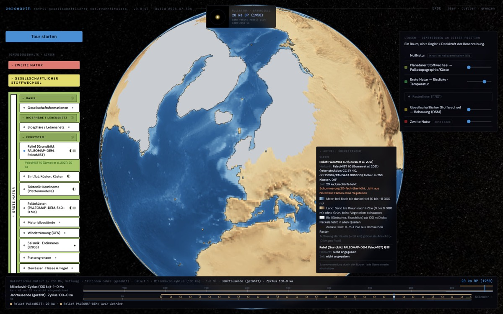
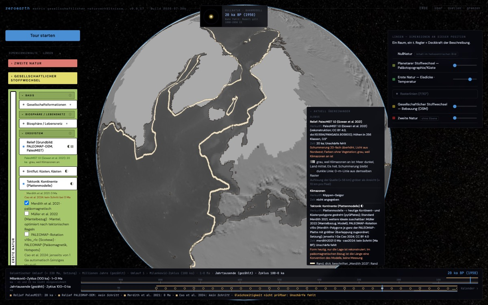
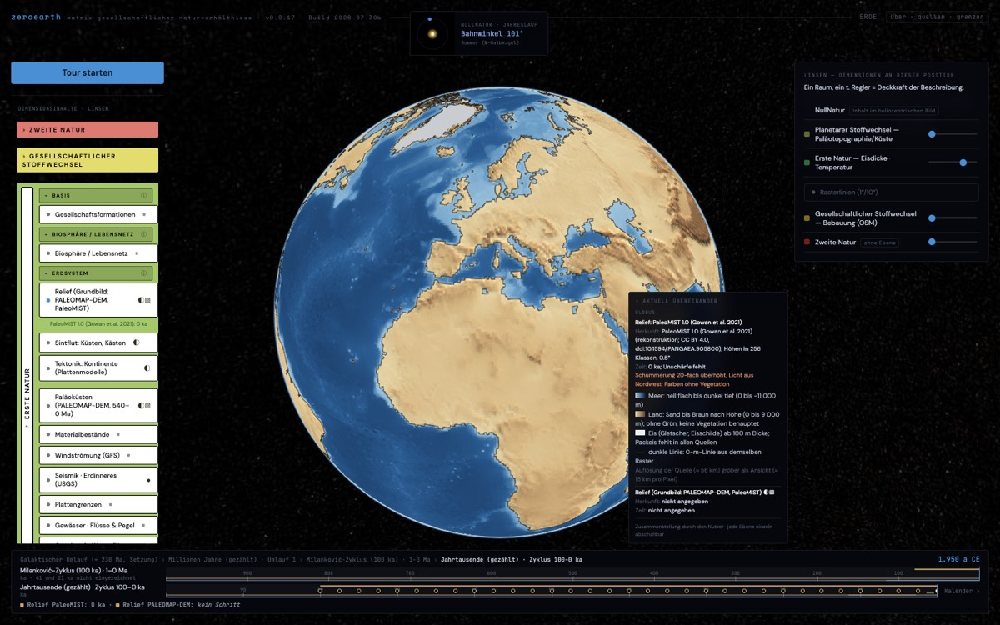
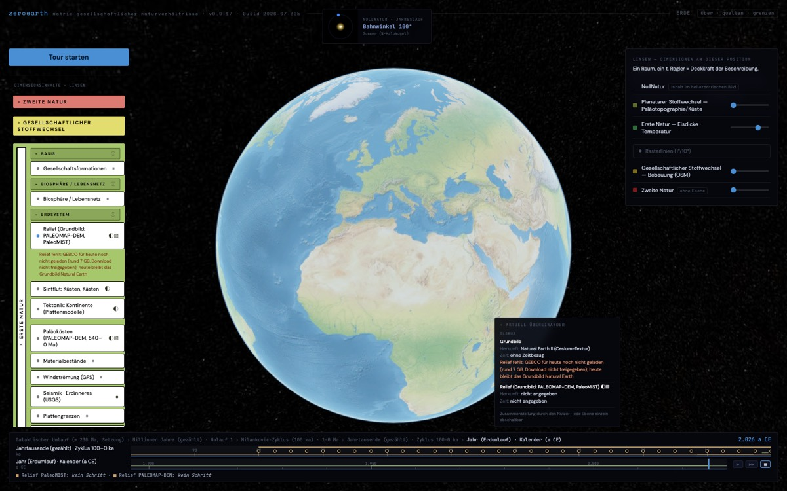
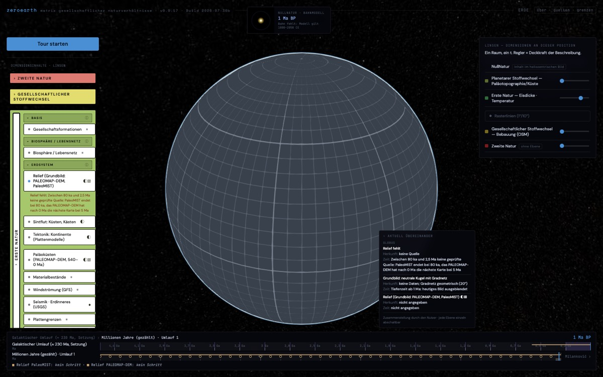
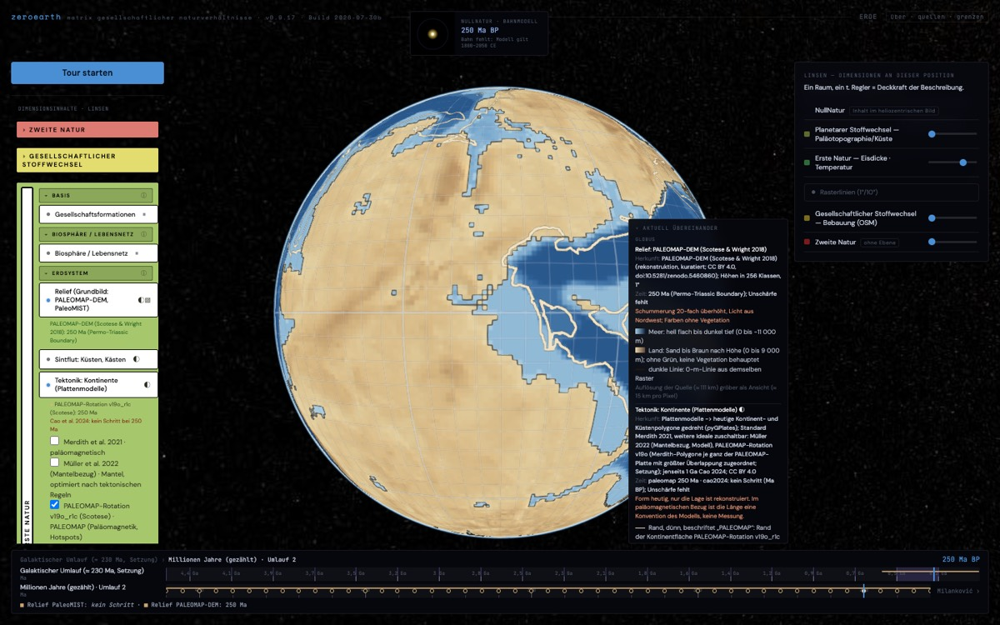
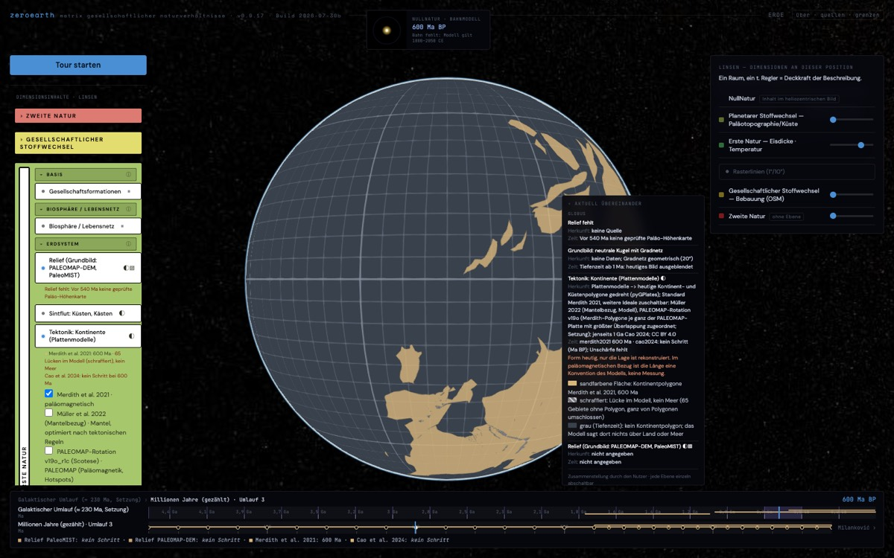

# Bericht: Relief als gemeinsames Grundbild (Plan)

Stand: 2026-11-06. Plan vom 2026-11-05; gebaut am 2026-11-06, siehe „Stand des Baus“ am Ende. Gemessen wurde an den lokalen Daten im Scratchpad (PALEOMAP-DEM 1°, PaleoMIST 0,25°); nichts davon liegt im Repo.

## 1. Gestaltung

- **Meer:** Blautöne nach Tiefe, von hell am Schelf bis dunkel in der Tiefsee.
- **Land:** Erdtöne von Sand bis Braun nach Höhe. **Kein Grün**, auch nicht heute: Das Relief behauptet keine Vegetation; Landpflanzen gibt es erst ab rund 470 Ma, und auch danach ist die Pflanzendecke eine eigene Ebene, nicht das Relief.
- **Eis:** In PaleoMIST enthält `paleo_topography` die Eisdicke. Ohne Maske erschiene ein Eisschild als hohes, braunes Land. Vorschlag: eine eigene Klasse Eis (hellgrau) aus `ice_thickness > 0` derselben Datei. PALEOMAP-DEM und GEBCO führen kein Eis; dort bleibt es Höhe.
- **Schummerung:** Licht aus Nordwest, 45° Höhe, als Setzung in der Legende. Sie wird im Browser aus den Höhen gerechnet und ist reine Darstellung, keine Aussage.
- **Grau-Modus:** Sobald eine Feld-Ebene an ist (Eis, Temperatur, Paläotemperatur, Klimazonen, Wind, später Biomasse), wird das Relief automatisch grau: Schummerung bleibt, Farbe fällt weg. So kollidieren die Farbskalen nicht. Die Liste der Feld-Ebenen steht an einer Stelle im Code; die Legende sagt „Relief grau, weil Feld-Ebene X an ist“.
- **Legende:** Farbskala mit Höhenstufen, Quelle des Reliefs mit Zeitschritt, Hinweis „Farben ohne Vegetation“.

## 2. Quellen je Zeitraum

| Zeitraum | Quelle | Auflösung | Herkunft | Lizenz | Bemerkung |
| --- | --- | --- | --- | --- | --- |
| heute | GEBCO_2025 | 15″, verkleinert auf 0,1° | beobachtung; wo das Typ-Gitter (TID) Interpolation oder Schwere-Vorhersage nennt, modell | gemeinfrei, mit Bedingungen | Download rund 7 GB (netCDF), muss lokal verkleinert werden |
| 80–0 ka | PaleoMIST 1.0 | 0,25° (lokal), Vorschlag 0,5° | rekonstruktion | CC BY 4.0 | 33 Schritte à 2,5 ka; Eis aus derselben Datei |
| 540–0 Ma | PALEOMAP-DEM (Scotese & Wright 2018) | 1° (0,1° gibt es, 207 MB) | rekonstruktion, kuratiert | CC BY 4.0 | 109 Karten à 5 Ma |
| vor 540 Ma | keine | – | fehlt | – | glatte, graue Kugel mit Gradnetz; Grund: „keine Paläo-Höhenkarte vor 540 Ma geprüft verfügbar“ |

**Lücke zwischen 80 ka und 5 Ma.**
- Nach der Karte bei 0 Ma kommt im PALEOMAP-DEM die nächste erst bei 5 Ma. PaleoMIST endet bei 80 ka.
- Dazwischen gibt es kein Relief, mit Grund ausgewiesen. Ein Ersatz durch die nächstliegende Karte wäre eine Erfindung.
- Kandidaten wie in `kern/BERICHT-tektonik.md`:
  - PRISM4 (Dowsett et al. 2016, USGS, CC0, NetCDF), eine Zeitscheibe um 3 Ma; ob eine Topographie enthalten ist, ist noch zu prüfen.
  - Die Randbedingungen von PlioMIP2, ebenfalls ungeprüft.

**Dreimal „heute“.**
- GEBCO 2025 (a CE), PaleoMIST 0 ka (Bezugsjahr 1950) und PALEOMAP 0 Ma (Holozän) zeigen alle die Gegenwart. Nach Regel 16 ist Gleichzeitigkeit ohne Unschärfe nicht prüfbar; zusammengeführt wird nichts.
- **Vorschlag (Setzung):** Die Zeile der Takt-Leiste entscheidet. Jahr-Zeile: GEBCO, ka-Zeilen: PaleoMIST, Ma-Zeilen: PALEOMAP. Die Legende nennt die gewählte Quelle; die anderen sind zuschaltbar.

## 3. Die 0-m-Linie als gemeinsamer Bezug

- Je Quelle und Schritt wird die 0-m-Linie aus demselben Relief abgeleitet. Für PaleoMIST in den Sintflut-Fenstern und für PALEOMAP gibt es sie schon (`data/sintflut_kuesten.json`, `data/tektonik_palaeokuesten.json`); GEBCO käme hinzu. So passen Küste und Relief immer zusammen.
- **Reihenfolge von unten nach oben:**
  1. Relief (Bild)
  2. Feld-Ebenen, dann Relief grau
  3. 0-m-Linie
  4. Linien und Flächen anderer Ebenen (Tektonik-Ränder, Sintflut-Kästen, Marker)
- **Achtung, Bezugsrahmen:** Das PALEOMAP-DEM liegt im Rahmen von PALEOMAP, die Kontinentpolygone von Merdith im paläomagnetischen Rahmen von Merdith. Übereinander gelegt passen sie nicht genau. Das ist eine Naht, kein Fehler, und muss im Bild stehen. Zu entscheiden: Soll bei Relief an die Tektonik standardmäßig der PALEOMAP-Rotation folgen, damit Relief und Kontinente aus einem Rahmen stammen?

## 4. Ableitbare Größen

Alle gerechnet, ohne eigene Annahmen über die Welt; Setzungen sind benannt. Herkunft nach Regel 6: alle Arten der Quelle, dazu `berechnet`.

| Größe | Rechnung | Setzung | Herkunft |
| --- | --- | --- | --- |
| Landfläche | Summe der Zellflächen mit Höhe > 0 | keine; bei PaleoMIST zählt eisbedecktes Land mit (oder getrennt ausweisen) | wie Quelle + berechnet |
| Schelffläche | Zellen zwischen 0 und −200 m | −200 m ist eine Setzung; Kocsis & Scotese nutzen −1400 m als Kontinentalrand; beide nebeneinander | wie Quelle + berechnet |
| Höhenstufen (Hypsometrie) | Flächenanteile je Stufe | Stufengrenzen (Vorschlag: −6000, −4000, −2000, −200, 0, 200, 1000, 2000, 4000 m) | wie Quelle + berechnet |
| mittlere Landhöhe | flächengewichtetes Mittel über Land | keine | wie Quelle + berechnet |
| Eisfläche (nur PaleoMIST) | Zellen mit Eisdicke > 0 | keine | rekonstruktion + berechnet |

Nicht vorgeschlagen: Küstenlänge. Sie hängt an der Auflösung (bei 0,25° anders als bei 1°) und wäre ohne diese Angabe irreführend.

**Proberechnung** (PaleoMIST 0,25°, eisbedecktes Land mitgezählt):

| Größe | 20 ka | 0 ka |
| --- | --- | --- |
| Landfläche | 175,6 Mio km² | 146,5 Mio km² |
| Schelffläche 0 bis −200 m | 6,0 Mio km² | 26,8 Mio km² |

Bei 20 ka lagen die heutigen Schelfe trocken.

## 5. Größe, Format, Aufwand

**Gemessen je Zeitschritt** (PNG optimiert):

| Quelle | 16-bit-Höhe (Terrarium) | 8-bit-Höhenklassen | fertig gefärbt (WebP 80) |
| --- | --- | --- | --- |
| PALEOMAP-DEM 1° | 26 KB | 16 KB | 9 KB |
| PaleoMIST 0,25° | 2,6 MB | 438 KB | 157 KB |
| PaleoMIST 0,5° | 663 KB | 126 KB | – |
| GEBCO 0,1° | nicht gemessen (kein Download) | geschätzt 2–5 MB | – |

Die 8-bit-Klassen sind 101 Tiefenstufen und 155 Höhenstufen, nach Wurzel verteilt; feiner nahe 0 m.

**Empfehlung: 8-bit-Höhenklassen als PNG, gefärbt und geschummert im Browser.**
- Nur so geht der Grau-Modus ohne zweiten Bildsatz, und die Farbskala bleibt an einer Stelle.
- Fertig gefärbte Bilder wären kleiner, bräuchten aber je Modus einen eigenen Satz.

**Summe:**

| Teil | Größe |
| --- | --- |
| PALEOMAP 109 × 16 KB | 1,7 MB |
| PaleoMIST 33 × 126 KB (0,5°) | 4,2 MB |
| GEBCO einmal | 2–5 MB |
| zusammen | rund 8–11 MB |

Mit PaleoMIST auf 0,25° kämen 14,5 MB statt 4,2 MB hinzu; dafür reicht die Küstenlinie der Sintflut-Fenster, die schon auf 0,25° vorliegt.

**Format im Globus:** wie die bisherigen Ebenen als `SingleTileImageryProvider` aus einem Canvas.

**Nicht empfohlen: Cesium-Terrain.**
- Es bräuchte eine Kachelung je Zeitschritt (quantized-mesh) und einen Terrain-Server oder vorab gerechnete Kacheln, also ein Vielfaches an Größe.
- Echtes 3D-Relief wäre auf Globusmaßstab kaum sichtbar.
- Die Überhöhung müsste nach Regel 10 als Zahl im Bild stehen.

**Aufwand:**

| Schritt | Umfang |
| --- | --- |
| Adapter `relief.py` (PALEOMAP, PaleoMIST mit Eismaske; GEBCO nach Download): Höhenklassen, 0-m-Linien, ableitbare Größen; Manifest, Kern-Einträge, Tests | rund ein Tag |
| Ebene im Browser: Färbung, Schummerung, Grau-Modus, Wahl der Quelle nach der Zeile der Takt-Leiste, Legende | rund ein Tag |
| GEBCO: Download rund 7 GB und Verkleinerung, im Scratchpad | Freigabe nötig (Download) |
| Prüfung im Browser, Bildschirmfotos | ein halber Tag |

**Risiken:**
- Schummerung aus 8-bit-Klassen kann Stufen zeigen. Vorher an einer Karte prüfen, sonst die Schummerung im Adapter vorrechnen und mitliefern.
- Bei PaleoMIST ist die Isostasie in der Topographie schon enthalten (laut Datei).

## Entschieden: Tektonik folgt mit Relief der PALEOMAP-Rotation (Max, 2026-11-06)

„Wenn möglich, im Idealfall müssen die ja überlappen.“ Geprüft habe ich, wie gut die gedrehten Kontinentpolygone (Merdith-Polygone, je Modell gedreht) mit dem PALEOMAP-DEM überlappen. Gemessen ist die flächengewichtete Überlappung (Schnitt durch Vereinigung) mit dem Kontinentalrand des DEM (Höhe > −1400 m, wie bei Kocsis & Scotese), auf 1°:

| Ma | Merdith 2021 | Müller 2022 | PALEOMAP v19o_r1c | PALEOMAP v3 |
| --- | --- | --- | --- | --- |
| 0 | 0,87 | 0,87 | 0,87 | 0,87 |
| 100 | 0,61 | 0,66 | 0,78 | 0,78 |
| 200 | 0,64 | 0,60 | 0,81 | 0,82 |
| 300 | 0,67 | 0,62 | 0,75 | 0,75 |
| 400 | 0,43 | 0,37 | 0,73 | 0,74 |
| 500 | 0,29 | 0,14 | 0,56 | 0,56 |
| 540 | 0,20 | 0,17 | 0,51 | 0,51 |

**Was die Zahlen zeigen**

- Die PALEOMAP-Rotation passt deutlich besser zum PALEOMAP-DEM. Beide stammen aus demselben Rahmen; bei 400 bis 540 Ma ist die Überlappung fast doppelt so groß wie bei Merdith.
- v19o_r1c und v3 unterscheiden sich kaum. v19o_r1c bleibt, weil sie schon gebaut ist und Kocsis & Scotese sie „for paleogeography“ ausweisen.
- Auch mit PALEOMAP ist die Deckung nicht vollständig.
  - Schon bei 0 Ma liegt sie bei 0,87: Kontinentpolygone und die −1400-m-Linie des DEM grenzen den Kontinent verschieden ab.
  - Mit dem Alter sinkt sie, weil die Polygone ihre heutige Form behalten, das DEM aber die Form der Zeit zeigt.
  - Der Rest ist also eine Naht zwischen „heutige Form, gedreht“ und „Paläo-Höhenkarte“, kein Fehler. Er bleibt sichtbar.

**Für den Bau**

- **Ist das Relief an,** wird die Tektonik-Ebene standardmäßig auf die PALEOMAP-Rotation umgestellt.
- **Merdith und Müller** bleiben zuschaltbar. Die Legende sagt dann: „anderer Bezugsrahmen als das Relief, Deckung schlechter (siehe Bericht)“.
- **Ohne Relief** bleibt Merdith der Standard.
- **Ein Test im Kern** hält die Überlappung je Stützstelle fest: Sie soll für PALEOMAP nicht unter die gemessenen Werte fallen.

Gemessen mit pyGPlates im Scratchpad (`rahmen.py`), Polygone nach Platte zugeordnet wie in `matrix-scharnier/adapter/tektonik.py`.

## Zu entscheiden

1. PaleoMIST global auf 0,5° (4,2 MB) oder 0,25° (14,5 MB)?
2. Eis als eigene Klasse im Relief (Vorschlag ja)?
3. ~~Soll mit Relief die Tektonik standardmäßig der PALEOMAP-Rotation folgen?~~ Entschieden: ja (siehe oben).
4. GEBCO laden (rund 7 GB, nur Scratchpad)?
5. Grenze des Schelfs: −200 m, −1400 m oder beide?

## Stand des Baus (2026-11-06)

**Entscheidungen**

- **Eis:** eigene Klasse ab 100 m Dicke, „vor allem Gletscher und Packeis“ (Max).
  - Gletscher und Eisschilde kommen aus `ice_thickness` von PaleoMIST.
  - Die Schwelle von 100 m ist meine Setzung und steht im Graphen (`relief/auswahl/eis`). Bei 0 ka ergibt sie 14,2 Mio km² Eis, dünneres Eis erscheint als Höhe.
  - **Packeis (Meereis) führt keine der Quellen.** Es steht als fehlend mit Grund in Daten, Graph und Legende.
- **PaleoMIST:** auf 0,5° (jeder zweite Gitterpunkt), 4,2 MB. Die Sintflut-Küsten bleiben auf 0,25°.
- **Schelf:** beide Grenzen nebeneinander, 0 bis −200 m und −200 bis −1400 m.
- **GEBCO:** nicht geladen. Für heute bleibt das Grundbild Natural Earth; „GEBCO fehlt“ steht mit Grund in Status und Legende.

**Gebaut**

- **`matrix-scharnier/adapter/relief.py`:**
  - 109 PALEOMAP-Karten (1°) und 33 PaleoMIST-Schritte (0,5°) als 8-bit-Höhenklassen.
  - Zusammen 5,9 MB PNG in `data/relief/`, dazu `data/relief.json` mit Klassentafel, Setzungen, dem, was fehlt, und den abgeleiteten Größen je Schritt: Landfläche, Schelf 0 bis −200 m, Rand −200 bis −1400 m, mittlere Landhöhe, Höhenstufen, Eisfläche.
- **Kern:** Adapter `kern/adapter/relief/` (Manifest, Transform) und `kern/test/relief.test.mjs`.
  - Je Quelle ein Feld mit der Höhe je Schritt (Verweis auf das PNG) und den Größen als Reihen. Die Größen tragen zusätzlich `berechnet`, die Höhe nicht.
  - Was fehlt, steht als eigener Eintrag mit Grund: heute/GEBCO, die Lücke 80 ka bis 2,5 Ma, vor 540 Ma, Packeis.
- **Ebene „Relief“, standardmäßig an:**
  - Die Farben entstehen im Browser: Meer blau nach Tiefe, Land Sand bis Braun, Eis hellgrau, kein Grün.
  - Schummerung mit Licht aus Nordwest und 20-facher Überhöhung; beides steht in der Legende (Regel 10).
  - Die 0-m-Linie wird aus demselben Raster gezogen.
  - Das Bild ist um eine halbe Zelle versetzt, damit die Gitterpunkte Zellmitten sind.
- **Welche Quelle gilt,** entscheidet die Zeile der Takt-Leiste: Jahr-Zeile heute (Natural Earth), ka-Zeilen PaleoMIST, Ma-Zeilen PALEOMAP. Zwischen 80 ka und 2,5 Ma und vor 540 Ma fehlt das Relief mit Grund; dann gilt die neutrale Kugel mit Gradnetz.
- **Grau-Modus:** automatisch, sobald eine Feld-Ebene mit Daten an ist (Eisdicke, Temperatur, Paläotemperatur, Klimazonen, Wind nur mit Winddaten). Status und Legende nennen den Grund.
- **Tektonik:**
  - Zeigt das Relief das PALEOMAP-DEM, folgt die Tektonik der PALEOMAP-Rotation, solange man nicht selbst gewählt hat.
  - Bei Relief zeigt sie nur den Rand der Kontinentfläche, damit das Relief sichtbar bleibt.
  - Merdith und Müller tragen dann in der Legende den Hinweis auf den anderen Bezugsrahmen.
- **Takt-Leiste:** Sie zeigt die Stützstellen beider Reliefquellen.

**Geprüft** in Chromium bei 20 ka (mit Eis), 20 ka grau, 0 ka (ka-Zeile, PaleoMIST), heute (Jahr-Zeile, Natural Earth), 1 Ma (Lücke), 250 Ma (PALEOMAP mit PALEOMAP-Rotation) und 600 Ma (fehlt).

- **Grau-Modus:** Im Repo liegt keine Feld-Ebene mit Daten. Für das Foto habe ich die Klimazonen-Ebene im Browser als „an“ gesetzt; in der normalen Ansicht wird das Relief derzeit nie grau.

**Noch offen**

- GEBCO für heute (Download rund 7 GB, Freigabe nötig).
- PRISM4 für die Lücke.
- Die Schummerung zeigt bei 1° (PALEOMAP) sichtbare Zellen; eine feinere Quelle (PALEOMAP 0,1°, 207 MB roh) wäre zu prüfen.

