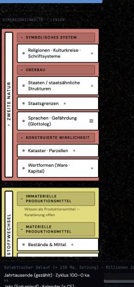
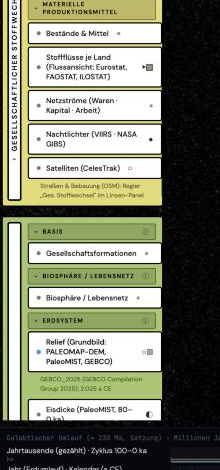
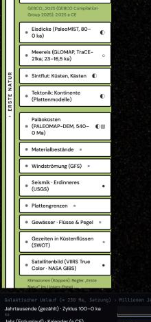
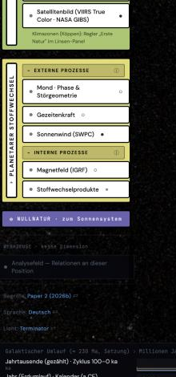
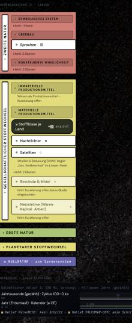
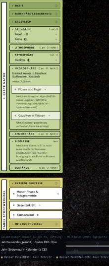
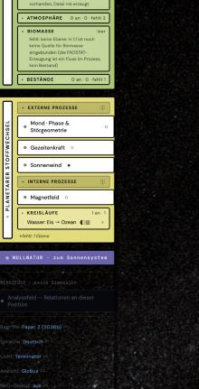
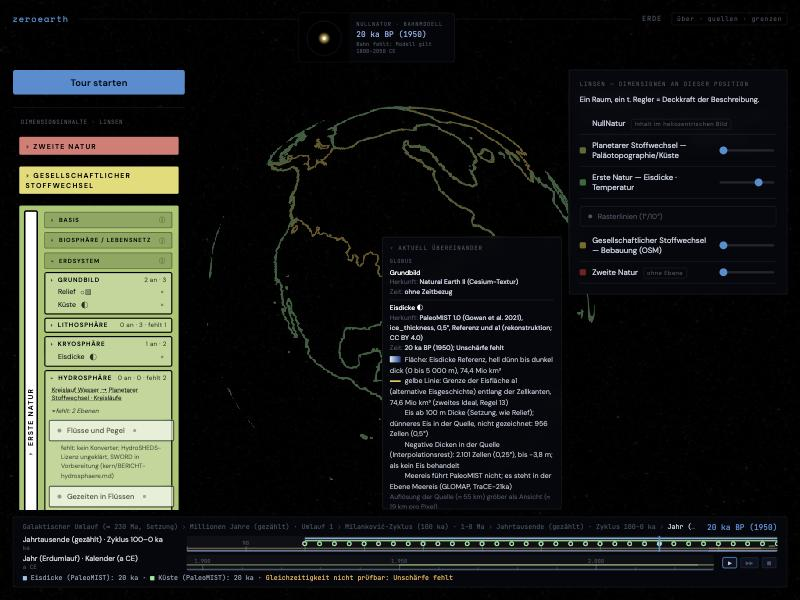

# Bericht: Seitenleiste neu ordnen

Plan: 2026-11-10, Branch `struktur`, nach `601f413`. Gebaut am 2026-11-11 nach den Entscheidungen von Max, siehe Abschnitt „Stand“ am Ende. Geprüft an `index.html` (Leiste, `EBENEN_HERKUNFT`, Abrufziele im Code) und an `data/`, `kern/adapter/`, `matrix-scharnier/adapter/`.
- **Nicht angefasst:** Die uncommitteten Änderungen von Max (`docs/strukturstand.md`, `kern/STAND.md`).
- **Maßgeblich:** `docs/strukturstand.md` (Regeln 1–16) und `docs/woerterbuch.md`.

## 0. Bildschirmfotos (Zustand vor dem Umbau)

Aufgenommen am 2026-11-10 im lokalen Server (`index.html`, v0.9.17, Erdansicht), alle Gruppen aufgeklappt, Fenster 1024 × 768. Die Leiste ist höher als das Fenster; daher vier Ausschnitte von oben nach unten. Unten liegt jeweils die Takt-Leiste über der Seitenleiste.

| Bild | Inhalt |
| --- | --- |
|  | 2. Natur; Anfang Gesellschaftlicher Stoffwechsel |
|  | Gesellschaftlicher Stoffwechsel; 1. Natur bis Eisdicke |
|  | 1. Natur · Erdsystem bis Klimazonen |
|  | Planetarer Stoffwechsel, Tür zur 0. Natur, Werkzeuge |

Die 0. Natur erscheint in der Erdansicht nur als Tür („NULLNATUR · zum Sonnensystem“); ihre Einträge stehen in der Sonnensystemansicht.

## 1. Bestandsaufnahme

**Spalten:**
- **Zustand:**
  - **Daten da:** Die Datei liegt in `data/`.
  - **Datei fehlt:** graues Quadrat in der Leiste.
  - **live:** Abruf eines fremden Dienstes zur Laufzeit.
  - **berechnet:** im Browser gerechnet, ohne Datei.
- **Weg:**
  - **data/ + kern:** Die Seite liest `data/`, ein Kern-Adapter prüft dieselbe Datei.
  - **data/ ohne kern:** Die Seite liest `data/`, kein Kern-Adapter.
  - **live:** Die Seite fragt den Dienst direkt.
  - **Browser:** Formel im Code.

| Gruppe · Unterkopf | Kennung | Name in der Leiste | Stapel/Unterebene | Datei bzw. Quelle | Zustand | Weg |
| --- | --- | --- | --- | --- | --- | --- |
| 2. Natur · Symbolisches System | `riss` | Religionen · Kulturkreise · Schriftsysteme | 2.3 | `data/marker.json` | Datei fehlt | data/ ohne kern |
| 2. Natur · Überbau | `ueberbau` | Staaten / staatsähnliche Strukturen | 2.2 | `data/marker.json` | Datei fehlt | data/ ohne kern |
| 2. Natur · Überbau | `grenzen` | Staatsgrenzen | 2.2 | `data/grenzen.geojson` | Datei fehlt | data/ ohne kern |
| 2. Natur · Überbau | `sprachen` | Sprachen · Gefährdung (Glottolog) | 2.2 (Träger 1.3) | `data/glottolog.json` | Daten da | data/ + kern (`glottolog`) |
| 2. Natur · Konstruierte Wirklichkeit | `kataster` | Kataster · Parzellen | 2.1 | `data/kataster.geojson` | Datei fehlt | data/ ohne kern |
| 2. Natur · Konstruierte Wirklichkeit | `ware` | Wertformen (Ware · Kapital) | 2.1 | `data/marker.json` | Datei fehlt | data/ ohne kern |
| Ges. Stoffwechsel · Immaterielle PM | – | Text „Wissen als Produktionsmittel – Kuratierung offen“ | Übergang | – | – (Text) | – |
| Ges. Stoffwechsel · Materielle PM | `bestaende` | Bestände & Mittel | Übergang | `data/marker.json` | Datei fehlt | data/ ohne kern |
| Ges. Stoffwechsel · Materielle PM | `fluss` | Stoffflüsse je Land (Flussansicht …) | Übergang | `data/stofffluss/*.json` | Daten da | data/ + kern (`eurostat`, `faostat`, `ilostat`, `stoffwechsel`) |
| Ges. Stoffwechsel · Materielle PM | `stroeme` | Netzströme (Waren · Kapital · Arbeit) | Übergang | `data/stroeme.json` | Datei fehlt | data/ ohne kern |
| Ges. Stoffwechsel · Materielle PM | `nachtlicht` | Nachtlichter (VIIRS · NASA GIBS) | Übergang (Spur) | NASA GIBS (WMTS) | live | live |
| Ges. Stoffwechsel · Materielle PM | `sats` | Satelliten (CelesTrak) | Übergang | CelesTrak (TLE) | live | live |
| Ges. Stoffwechsel · Materielle PM | – | Text „Straßen & Bebauung (OSM): Regler …“ | Übergang | OpenStreetMap-Kacheln | live | live |
| 1. Natur · Basis | `basis` | Gesellschaftsformationen | 1.3 | `data/marker.json` | Datei fehlt | data/ ohne kern |
| 1. Natur · Biosphäre / Lebensnetz | `unterbau` | Biosphäre / Lebensnetz | 1.2 | `data/unterbau.json` | Datei fehlt | data/ ohne kern |
| 1. Natur · Erdsystem | `relief` | Relief (Grundbild: PALEOMAP-DEM, PaleoMIST, GEBCO) | 1.1 | `data/relief.json` | Daten da | data/ + kern (`relief`) |
| 1. Natur · Erdsystem | `eis` | Eisdicke (PaleoMIST, 80–0 ka) | 1.1 Kryosphäre | `data/eis.json` | Daten da | data/ + kern (`eis`) |
| 1. Natur · Erdsystem | `meereis` | Meereis (GLOMAP, TraCE-21ka; 23–16,5 ka) | 1.1 Kryosphäre | `data/meereis.json` | Daten da | data/ + kern (`meereis`) |
| 1. Natur · Erdsystem | `sintflut` | Sintflut: Küsten, Kästen | 1.1 (Küste) + Tour | `data/kuesten.json`, `data/sintflut.json` | Daten da | data/ + kern (`sintflut`) |
| 1. Natur · Erdsystem | `tektonik` | Tektonik: Kontinente (Plattenmodelle) | 1.1 Lithosphäre | `data/tektonik_umrisse.json` | Daten da | data/ + kern (`tektonik`) |
| 1. Natur · Erdsystem | `palaeokueste` | Paläoküsten (PALEOMAP-DEM, 540–0 Ma) | 1.1 Lithosphäre | `data/tektonik_palaeokuesten.json` | Daten da | data/ + kern (Zusatzdatei des Adapters `tektonik`) |
| 1. Natur · Erdsystem | `erste_natur` | Materialbestände | 1.1 (Bestand) | `data/marker.json` | Datei fehlt | data/ ohne kern |
| 1. Natur · Erdsystem | `wind` | Windströmung (GFS) | 1.1 Atmosphäre | `data/manifest.json` + `.f32` | Datei fehlt | data/ ohne kern |
| 1. Natur · Erdsystem | `seismik` | Seismik · Erdinneres (USGS) | 1.1 Lithosphäre | USGS-Erdbebenfeed (2,5+, Monat) | live | live |
| 1. Natur · Erdsystem | `platten` | Plattengrenzen | 1.1 Lithosphäre | `data/plattengrenzen.geojson` | Datei fehlt | data/ ohne kern |
| 1. Natur · Erdsystem | `gewaesser` | Gewässer · Flüsse & Pegel | 1.1 Hydrosphäre | `data/fluesse.geojson`, `data/pegel.json`; Abfluss live über Open-Meteo Flood-API | Datei fehlt (Konverter fehlt auch) | data/ ohne kern + live |
| 1. Natur · Erdsystem | `gezeiten` | Gezeiten in Küstenflüssen (SWOT) | 1.1 Hydrosphäre | `data/gezeiten.json` | Datei fehlt; **Konverter `matrix-scharnier/adapter/gezeiten.py` und Workflow `gezeiten.yml` sind da**, die Datei wurde nie erzeugt | data/ ohne kern |
| 1. Natur · Erdsystem | `satbild` | Satellitenbild (VIIRS True Color · NASA GIBS) | 1.1 (Grundbild) | NASA GIBS (WMTS) | live | live |
| 1. Natur · Erdsystem | – | Text „Klimazonen (Köppen): Regler …“ | 1.1 Atmosphäre | `data/manifest.json` (`koeppen`) | Datei fehlt | data/ ohne kern |
| Plan. Stoffwechsel · Externe Prozesse | `moon` | Mond · Phase & Störgeometrie | Übergang 0/1 | Formel (gekürzte Reihe) | berechnet | Browser |
| Plan. Stoffwechsel · Externe Prozesse | `tidal` | Gezeitenkraft | Übergang 0/1 | Formel | berechnet | Browser |
| Plan. Stoffwechsel · Externe Prozesse | `solarwind` | Sonnenwind (SWPC) | Übergang 0/1 | NOAA SWPC (Plasma, Magnetfeld, 1 Tag) | live | live |
| Plan. Stoffwechsel · Interne Prozesse | `magfield` | Magnetfeld (IGRF) | Übergang 0/1 | IGRF-Koeffizienten im Code | berechnet | Browser |
| Plan. Stoffwechsel · Interne Prozesse | `pm` | Stoffwechselprodukte | Übergang 0/1 | `data/marker.json` | Datei fehlt | data/ ohne kern |
| 0. Natur · Solarer Raum | `ekliptik` | Ekliptik-Ringe | 0.3 | Formel | berechnet | Browser |
| 0. Natur · Solarer Raum | `orbits` | Planetenbahnen | 0.3 | Standish (JPL), Formel | berechnet | Browser |
| 0. Natur · Interstellarer Raum | `apex` | Sonnenapex-Drift | 0.2 | Formel | berechnet | Browser |
| Werkzeuge · keine Dimension | `analyse` | Analysefeld – Relationen an dieser Position | – (Werkzeug) | – | – | Browser |

**Zählung:**
- **Ebenen:** 35 mit Kennung.
  - **Daten da:** 8 (`sprachen`, `fluss`, `relief`, `eis`, `meereis`, `sintflut`, `tektonik`, `palaeokueste`). Planeten und Nachbarsterne haben Daten, stehen aber nicht in der Leiste, sondern in der Sonnensystemansicht.
  - **Datei fehlt:** 15, auf 9 Dateien. Allein `data/marker.json` hängt an **7** Ebenen (`riss`, `ueberbau`, `ware`, `bestaende`, `basis`, `erste_natur`, `pm`).
  - **live:** 5.
  - **berechnet:** 6.
- **Texte:** 3 reine Textzeilen ohne Schalter (Wissen als PM, OSM-Regler, Köppen-Regler).
- **Gruppe 2. Natur:** Bis auf `sprachen` sind alle Einträge leere Hüllen.

**Unstimmigkeit in den Grundtexten:**
- `docs/strukturstand.md` (Abschnitt 1. Natur) nennt im Erdsystem Atmosphäre, Hydrosphäre, Lithosphäre, **Kryosphäre** und Biomasse.
- `docs/woerterbuch.md` (Eintrag Erdsystem) nennt Atmosphäre, Hydrosphäre, Lithosphäre und Biomasse, **ohne Kryosphäre**.
- Der Kern (`SPHAEREN`) folgt dem Strukturstand. Das ist zur Kenntnis; die Dokumente ändere ich nicht.

## 2. Unterordner in 1.1 Erdsystem

**Aufbau:** Je Sphäre ein aufklappbarer Ordner, standardmäßig zu.
- **Kopf:** Name und Zähler „2 an · 3“ (eingeschaltet · vorhanden).
- **Eingeschaltete Ebenen im zugeklappten Ordner:** Sie bleiben trotzdem sichtbar, als **Kurzzeile unter dem Kopf**, mit Herkunftszeichen und Ausschalter. Wer einen Ordner zuklappt, verliert nichts aus dem Blick. Freies Übereinanderlegen bleibt, keine Tabs.
- **Zuklappen** ändert nie, ob eine Ebene an ist.

| Ordner (Reihenfolge) | Ebenen | Bemerkung |
| --- | --- | --- |
| **Grundbild** | Relief, Satellitenbild | Was unter allem liegt; das Relief ist zugleich der Bezug für die Küste |
| **Lithosphäre** | Tektonik, Paläoküsten, Plattengrenzen, Seismik | Plattengrenzen: Datei fehlt |
| **Kryosphäre** | Eisdicke, Meereis | später Gebirgsgletscher (`kern/BERICHT-meereis.md`, Abschnitt 8) |
| **Hydrosphäre** | Gewässer, Gezeiten; Vorschlag: Küste (aus Sintflut, siehe 6) | beide Dateien fehlen; Plan in `kern/BERICHT-hydrosphaere.md` |
| **Atmosphäre** | Wind, Klimazonen | beide hängen an `data/manifest.json` (fehlt). Klimazonen bekommen einen eigenen Schalter statt der Textzeile |
| **Biomasse** | – | **leer**: In 1.1 gibt es noch keine Biomasse-Ebene. Sichtbar als „fehlt: keine Ebene, Grund: noch keine Quelle eingebunden“ (Regel 8). Die FAOSTAT-Erzeugung ist ein Fluss im Prozess, kein Bestand in 1.1 |
| **Bestände** | Materialbestände | Datei fehlt |

**Reihenfolge:** Grundbild oben, dann die Sphären von innen nach außen (Gestein → Eis → Wasser → Luft), dann Biomasse und Bestände. Das ist eine Setzung (Regel 7); die Reihenfolge der Leiste sagt nichts über Relationen (Regel 1).

**Technik (für später):**
- Der Ordner ist eine neue Ebene im DOM (`
` mit eigenem Kopf), kein neuer Unterkopf in `LABELS.subHeads`.
- Der Prüfer `matrix-scharnier/pruefe.mjs` prüft die Unterköpfe gegen `LABELS.subHeads` („deckungsgleich (13)“). Ordner dürfen dort nicht als Unterkopf erscheinen, sonst muss der Prüfer mit.

## 3. Ordner „Kreisläufe“ (Vorschlag)

- **Wozu:** Flüsse zwischen Sphären, also Prozesse im Übergang „planetarer Stoffwechsel“, nicht Zustände einer Sphäre.
- **Erster Inhalt: Wasser.**
  - **Eis → Ozean:** Die Bilanz der Sintflut steht schon im Kern (`sintflut/relation/eis-ozean/<ideal>`, `sintflut/prozess/wasserumverteilung`) und in der Tour, aber in der Leiste nirgends.
  - **Später:** Niederschlag → Abfluss → Meer (Hydrosphäre), siehe Hydrosphären-Plan.
- **Ort:** Zwei Möglichkeiten:
  - **(a)** als letzter Ordner in 1.1 Erdsystem;
  - **(b)** in der Gruppe **Planetarer Stoffwechsel** unter „Interne Prozesse“. Dort laut Strukturstand der richtige Ort, weil der Prozess keinem Stapel gehört.
- **Vorschlag:** (b), mit einem Querverweis im Hydrosphären-Ordner („Kreislauf Wasser → Planetarer Stoffwechsel“).

## 4. Kurze Namen

- **Regel:** Der Name sagt nur, *was* gezeigt wird. Quelle und Zeitraum stehen in der Statuszeile darunter, sobald die Ebene an ist; das tun die meisten Ebenen schon (`*-status`).
- **Vorschläge:**

| heute | kurz |
| --- | --- |
| Relief (Grundbild: PALEOMAP-DEM, PaleoMIST, GEBCO) | Relief |
| Eisdicke (PaleoMIST, 80–0 ka) | Eisdicke |
| Meereis (GLOMAP, TraCE-21ka; 23–16,5 ka) | Meereis |
| Tektonik: Kontinente (Plattenmodelle) | Kontinente |
| Paläoküsten (PALEOMAP-DEM, 540–0 Ma) | Paläoküsten |
| Windströmung (GFS) | Wind |
| Seismik · Erdinneres (USGS) | Erdbeben |
| Gewässer · Flüsse & Pegel | Flüsse und Pegel |
| Gezeiten in Küstenflüssen (SWOT) | Gezeiten in Flüssen |
| Satellitenbild (VIIRS True Color · NASA GIBS) | Satellitenbild |
| Stoffflüsse je Land (Flussansicht: Eurostat, FAOSTAT, ILOSTAT) | Stoffflüsse je Land |
| Nachtlichter (VIIRS · NASA GIBS) | Nachtlichter |
| Satelliten (CelesTrak) | Satelliten |
| Sonnenwind (SWPC) | Sonnenwind |
| Magnetfeld (IGRF) | Magnetfeld |
| Sprachen · Gefährdung (Glottolog) | Sprachen |

- **Herkunftszeichen:** Es bleibt immer hinter dem Namen (●◐○▨■), auch bei ausgeschalteter Ebene. Damit steht Regel 6 in der Leiste.
- **Ausnahme:** Steht ein Zeitraum für eine **grundsätzliche Grenze** (etwa „nur 23–16,5 ka“ beim Meereis), gehört er in die Statuszeile *und* in den Tooltip des Namens, nicht in den Namen.

## 5. Leere Hüllen (Regel 8: Fehlendes bleibt sichtbar)

**Ausgangslage:** 15 Ebenen ohne Datei. Heute zeigen sie das graue Quadrat und sonst nichts; den Grund sieht man nur im Tooltip („fehlt: data/… liegt nicht vor“), und der ist ein Dateiname, kein Grund.

| Variante | Wie | Für | Gegen |
| --- | --- | --- | --- |
| **A** (Vorschlag) | Je Ordner unten **eine zugeklappte Zeile „fehlt: n Ebenen“**. Aufgeklappt stehen die Namen, je mit Grund in Worten, etwa „Plattengrenzen: Datei nicht erzeugt; Konverter fehlt“ | Nichts verschwindet; der Ordner zeigt zuerst, was da ist | ein Klick mehr, um das Fehlende zu sehen |
| **B** | Leere Hüllen bleiben an ihrem Platz, grau, ohne Schalter, mit Grund als zweite Zeile | maximal sichtbar | lange Leiste; in der 2. Natur fast nur Graues |
| **C** | Eigener Ordner „Fehlt“ am Ende jeder Gruppe | klar getrennt | löst die Fehlenden aus ihrer Sphäre; man sieht nicht mehr, *wo* etwas fehlt |

**Gründe in Worten**, aus dem, was im Repo zu finden ist:
- `marker.json` (7 Ebenen): Kuratierung offen, keine Quelle eingebunden.
- `grenzen.geojson`, `kataster.geojson`: kein Adapter; Kataster sind regional (siehe Haus-Station).
- `plattengrenzen.geojson`: kein Konverter.
- `stroeme.json`: Kuratierung offen.
- `unterbau.json`: kein Konverter.
- `fluesse.geojson`: Konverter `gewaesser_to_zef.py` fehlt (siehe Hydrosphären-Plan).
- `gezeiten.json`: **Konverter da, Datei nie erzeugt.** Das ist der einzige Fall, in dem nur ein Lauf fehlt.
- `manifest.json` (Wind, Klimazonen, ältere Raster): Rasterdatensätze liegen nicht im Repo, so steht es in der Konsolenwarnung.

**Die Gründe gehören in die Daten, nicht in den Code:** ein Feld `fehlt_grund` je Eintrag in `EBENEN_HERKUNFT`. So prüfen Seite und Prüfer denselben Text.

**Nichts wird still entfernt.** Ebenen, deren Plan aufgegeben ist, stehen als „fehlt, Grund: nicht weiter verfolgt (Datum, Entscheidung)“.

## 6. „Sintflut: Küsten, Kästen“

Die Ebene vereint zwei Dinge:
- **Küste:** die globale Grenze Land/Meer aus PaleoMIST, alle 33 Schritte 80–0 ka. Das ist eine Ebene des Erdsystems, die Grenze zwischen Hydrosphäre und Lithosphäre, aus demselben Raster wie das Relief.
- **Kästen:** die sechs Fokusfenster der Sintflut-Tour, eine Setzung der Tour.

**Vorschlag:**
- **Küste** wird eigene Ebene „Küste (Meeresspiegel)“ im Ordner **Hydrosphäre**. Alternative: im Grundbild neben dem Relief, weil sie dieselbe Quelle hat; Hinweis im Tooltip.
- **Kästen** erscheinen nur in der Tour (die Tour schaltet sie ein) und sonst als Auswahl in der Legende, nicht als Schalter in der Leiste.

## 7. Andere Gruppen

- **2. Natur:** Keine Unterordnung nötig, je Unterkopf 1–2 Einträge. **Aber:** 5 von 6 Einträgen sind leere Hüllen; dort bringt Variante A den größten Gewinn.
- **Gesellschaftlicher Stoffwechsel:** keine Unterordnung nötig (5 Einträge unter „Materielle PM“).
  - Die Flussansicht ist eine **Ansicht**, kein Schalter. Sie sollte als Knopf mit anderem Aussehen erscheinen (öffnet ein Fach), damit sie nicht wie eine Ebene wirkt.
- **Planetarer Stoffwechsel:** keine Unterordnung nötig. Hier gehört der Ordner „Kreisläufe“ hin (Vorschlag in Abschnitt 3).
- **0. Natur:** keine Unterordnung nötig.
- **Werkzeuge:** Das Analysefeld steht schon richtig im eigenen Bereich „Werkzeuge · keine Dimension“ unter der Tür zur 0. Natur. Nichts zu tun.
- **1. Natur außerhalb des Erdsystems:** Basis und Biosphäre haben je 1 Eintrag (beide leer). Keine Unterordnung nötig.

## Stand (2026-11-11): gebaut

Alle Entscheidungen von Max aus Teil A (1–12) sind in `index.html` umgesetzt; Punkt 13 (Wörterbuch) bleibt bei Max. Geprüft im lokalen Server (Erdansicht, 20 ka BP): keine Fehler in der Konsole außer den erwarteten 404 der fehlenden Dateien. `matrix-scharnier/pruefe.mjs` ist deckungsgleich (13 Unterköpfe, kein neuer Unterkopf).

| Bild | Inhalt |
| --- | --- |
|  | 2. Natur und Gesellschaftlicher Stoffwechsel: kurze Namen, je Schicht unten „fehlt: n Ebenen“ (aufgeklappt mit Grund), die Flussansicht als dunkler Knopf mit dem Zusatz „Ansicht“ |
|  | 1.1 Erdsystem mit sieben Ordnern, Zähler im Kopf; zugeklappte Ordner zeigen eingeschaltete Ebenen als Kurzzeile (Relief, Küste, Eisdicke); Hydrosphäre und Biomasse aufgeklappt |
|  | Planetarer Stoffwechsel: Ordner „Kreisläufe“ unter Interne Prozesse, zugeklappt mit Kurzzeile „Wasser: Eis → Ozean“ |
|  | Ganze Seite bei 20 ka BP: Küste (grün) als eigene Ebene, Eisdicke, Legende |

**Was gebaut ist** (Nummern wie in Max' Entscheidung):

1. **Ordner in 1.1:**
   - Grundbild (Relief, Küste, Satellitenbild);
   - Lithosphäre (Kontinente, Paläoküsten, Plattengrenzen, Erdbeben);
   - Kryosphäre (Eisdicke, Meereis);
   - Hydrosphäre (Flüsse und Pegel, Gezeiten in Flüssen);
   - Atmosphäre (Wind, Klimazonen);
   - Biomasse;
   - Bestände (Materialbestände).
   - **Technik:** `
` im Markup, kein neuer Unterkopf. Der Prüfer bleibt unverändert.
2. **Biomasse:** leerer Ordner, Kopf „leer“, aufgeklappt mit Grund: „in 1.1 ist noch keine Quelle für Biomasse eingebunden (die FAOSTAT-Erzeugung ist ein Fluss im Prozess, kein Bestand)“. Der Grund steht als `data-leer` am Ordner, weil es keine Ebene gibt, an der `fehlt_grund` hängen könnte.
3. **Kurzzeile:**
   - Ein zugeklappter Ordner zeigt jede eingeschaltete Ebene mit Namen, Herkunftszeichen und „ד zum Ausschalten.
   - Zuklappen schaltet nichts ab.
   - **Zähler:** „n an · m“ (eingeschaltet · mit Daten), dazu „fehlt k“.
4. **Kreisläufe:**
   - **Ort:** Ordner im Planetaren Stoffwechsel unter „Interne Prozesse“.
   - **Querverweis:** Im Ordner Hydrosphäre steht „Kreislauf Wasser → Planetarer Stoffwechsel · Kreisläufe“. Ein Klick öffnet Gruppe, Schicht und Ordner.
5. **Erster Kreislauf „Wasser: Eis → Ozean“:**
   - **Quelle:** Die Seite lädt den Kern-Adapter `sintflut` (dieselbe `transform.mjs` wie die Tests, Regel 14) und zeigt je Ideal (Referenz, a1) die Relation `sintflut/relation/eis-ozean/<ideal>`. Sie rechnet nichts selbst.
   - **Bilanz 20–0 ka:**
     - Referenz: Eis gab 42,1 · 10¹⁸ kg ab, der Ozean nahm 45,0 · 10¹⁸ kg auf, Rest 6,8 %, Toleranz 10 %.
     - a1: ebenso, Rest 6,8 %.
   - **Zur Masterzeit:** Abstand von Eis- und Ozeanvolumen zu heute, nur an Schritten der Quelle (±1,25 ka); sonst steht „fehlt“.
   - **Prüfart:** innere Stimmigkeit. Die Dichten sind Annahmen von zeroearth.
6. **Leere Hüllen, Variante A:**
   - Ebenen ohne Datei wandern beim Laden ans Ende ihres Ordners bzw. ihrer Schicht, unter eine zugeklappte Zeile „fehlt: n Ebenen“.
   - Aufgeklappt stehen dort die Schalter mit Grund. Die Schalter bleiben bedienbar; nichts ist entfernt.
   - Ob eine Datei fehlt, entscheidet weiterhin die HEAD-Prüfung in `herkunftszeichen()`.
7. **`fehlt_grund`** in `EBENEN_HERKUNFT` für alle 16 Ebenen, deren Datei fehlen kann (15 bisher und neu `klima`). Ohne Feld schreibt die Seite „Datei … liegt nicht vor“.
8. **Kurze Namen** wie in Abschnitt 4. Quellen stehen in Statuszeile, Tooltip und Legende.
9. **Küste:**
   - **Ebene:** eigene Ebene `kueste` im Grundbild (`KuesteLayer`). PaleoMIST, alle 33 Schritte 80–0 ka, nur Stützstellen (±1,25 ka); außerhalb „fehlt“.
   - **Nicht doppelt:** Zeichnet das Relief die PaleoMIST-Küste schon, zeichnet die Ebene sie nicht noch einmal. Die Sintflut-Ebene zeichnet keine Küste, solange `kueste` an ist.
   - **Takt-Leiste und Legende:** Die Takt-Leiste kennt die Stützstellen, die Legende hat einen eigenen Eintrag.
10. **Kästen der Sintflut:**
    - **Leiste:** kein Schalter mehr.
    - **Tour:** Die Tour schaltet sie wie bisher ein.
    - **Legende:** Unten steht der Schalter „Kästen der Sintflut-Tour einblenden/ausblenden (Setzung der Tour)“. Die Legende nennt die Ebene „Sintflut: Kästen der Tour“.
    - **Links:** Alte Links mit `o=sintflut` gehen weiter.
11. **Flussansicht:** dunkler, runder Knopf „⇲ Stoffflüsse je Land“ mit dem Zusatz „Ansicht“, kein Punkt-Schalter.
12. **Klimazonen:**
    - **Schalter:** eigener Schalter `klima` im Ordner Atmosphäre; dieselbe Rasterebene wie im Linsen-Panel.
    - **Zustand:** Weil `data/manifest.json` fehlt, steht er unter „fehlt“ mit Grund. Eingeschaltet meldet er „fehlt“, statt etwas zu zeigen.
    - **Textzeile:** Die frühere Textzeile ist entfernt.

**Nebenbei korrigiert:** `EBENEN_HERKUNFT.gewaesser` sagte „Flussnetz kuratiert“; jetzt steht dort „modell, berechnet“, mit Verweis auf `kern/BERICHT-hydrosphaere.md`.

**Nicht geändert:** `docs/`, `ZEIT_RAUM.md`, Max' uncommittete Dateien.

## Stand (2026-11-12): Biomasse in die Biosphäre

- **Leiste:** Auf Anweisung von Max liegt der leere Ordner **Biomasse** jetzt unter der Schicht „Biosphäre / Lebensnetz“, nicht mehr im Erdsystem. 1.1 hat damit sechs Ordner.
- **Grund im Ordner:** „noch keine Quelle für Biomasse eingebunden (vorgesehen laut Strukturstand: Bar-On et al. 2018, Biomasse je Hauptzweig)“.
- **Nicht geändert:**
  - `docs/strukturstand.md` führt Biomasse weiter als Sphäre von 1.1 im Erdsystem („1.1 Biomasse: der stoffliche Teil, ein Bestand“).
  - Der Kern (`SPHAEREN` in `kern/schema.mjs`, Test in `regeln.test.mjs`) folgt dem Strukturstand und kennt `biomasse` als Sphäre in 1.1.
  - Die Leiste weicht hier also von Strukturstand und Kern ab. Siehe Frage 5.

## Stand (2026-11-12): Sprache, Schrift, Nachtlichter, Satelliten umgehängt

Entscheidung Max (2026-11-12): „Nachtlichter und Satelliten gehören in konstruierte Wirklichkeit. Sprache ist Teil/Grundlage des symbolischen Systems, Schrift ist institutionalisierte Sprache“, und: „Schrift in Überbau“.

- **Symbolisches System (2.3):**
  - **Sprachen:** von 2.2 hierher verschoben.
  - **`riss`:** heißt jetzt „Religionen · Kulturkreise“, ohne „Schriftsysteme“.
- **Überbau (2.2):**
  - **Neue Ebene „Schriftsysteme“** (`schrift`), gedacht für Schrift als Norm (Rechtschreibung, Kanon, Amtssprache).
  - **Ohne Quelle:** Sie steht unter „fehlt“ mit dem Grund „vorgesehen ISO 15924, keine Quelle eingebunden“.
  - **Kein Schalter:** Es gibt nichts zu zeichnen. `data/schrift.json` gibt es nicht.
- **Konstruierte Wirklichkeit (2.1):** Nachtlichter und Satelliten sind aus dem gesellschaftlichen Stoffwechsel (materielle Produktionsmittel) hierher verschoben. Dort bleiben Bestände, Stoffflüsse und Netzströme.
- **Kern:** Der Glottolog-Adapter führt Sprachen jetzt in 2.3.
  - **Was gleich bleibt:**
    - Sie verweisen weiter auf `glottolog/zeichensystem`, das symbolische System als Ganzes.
    - Der Träger ist weiter die Sprachgemeinschaft (1.3).
  - **Geändert:**
    - Manifest: `stapel` [2.3, 1.3], Einordnung mit Datum.
    - Test: Keine Sprache steht mehr in 2.2.
    - Die Leiste filtert die Sprachen nach 2.3 und schließt den Eintrag `zeichensystem` aus.
  - **Nicht berührt:** Nachtlichter und Satelliten haben keinen Kern-Adapter. Bei ihnen ändert sich nur die Leiste.
- **Nebenbei behoben:** Die Satelliten-Ebene schrieb ihren Status in `sat-status`, die Leiste hat aber `sats-status`. Darum war die Statuszeile immer leer. Der Fehler bestand schon vorher. Jetzt erscheint der Status. Beim Test lieferte CelesTrak nach dem Neuladen HTTP 403, und die Zeile zeigte das richtig an.
- **Geprüft im Browser bei 1280 × 900:**
  - Reihenfolge der Ebenen in der Leiste wie oben.
  - Sprachen: Die Zählung ist dieselbe wie vorher (7 992 Sprachen in 8 Kategorien).
  - Nachtlichter und Satelliten lassen sich schalten.
  - In der Konsole stehen nur 404-Fehler, und zwar von den Prüfanfragen nach Dateien, die fehlen. Das war schon vorher so.
- **Strukturstand (nicht geändert, nur gemeldet):**
  - Abschnitt „Sprache und Schrift“ stimmt mit der neuen Lage überein.
  - Die Liste weiter unten sagt dagegen noch „Sprache braucht einen Überbau; konkrete Sprachen in 2.2“. Das widerspricht der neuen Lage.

## Offen, zur Entscheidung

Die Fragen 1–13 vom 2026-11-10 sind entschieden (siehe „Stand“). Neu:

1. ~~Sprache und Schrift~~ **Erledigt (2026-11-12):** siehe „Stand (2026-11-12): Sprache, Schrift, Nachtlichter, Satelliten umgehängt“.
2. **Kurzzeile bei „fehlt“-Ebenen:** Ist eine Ebene ohne Datei eingeschaltet (etwa Klimazonen), zählt sie als „an“ und steht in der Kurzzeile mit ■. So lassen oder solche Schalter sperren?
3. **Kreislauf zugeklappt:** Die Bilanz steht in der Statuszeile im Ordner und ist bei zugeklapptem Ordner nicht zu sehen. Soll sie in die Legende oder in ein eigenes Fach wie die Flussansicht?
4. **Schichten außerhalb von 1.1** (Basis, Biosphäre, Konstruierte Wirklichkeit) bestehen jetzt fast nur aus einer Zeile „fehlt“. Sollen ganz leere Schichten ebenfalls einen Kopf „leer“ bekommen wie der Ordner Biomasse?
5. **Biomasse im Kern:** Soll die Sphäre `biomasse` aus 1.1 (`SPHAEREN`) heraus und Biomasse als Bestand der Biosphäre (1.2) geführt werden? Das ginge erst, wenn der Strukturstand angepasst ist; ich ändere `docs/` nicht.
