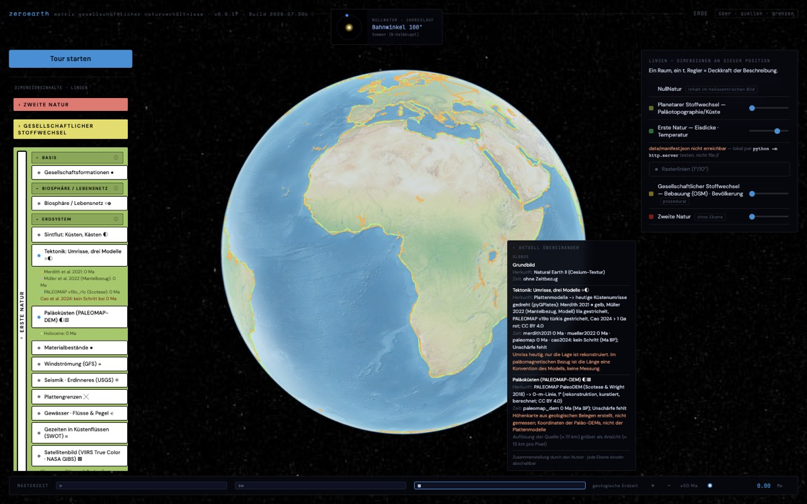
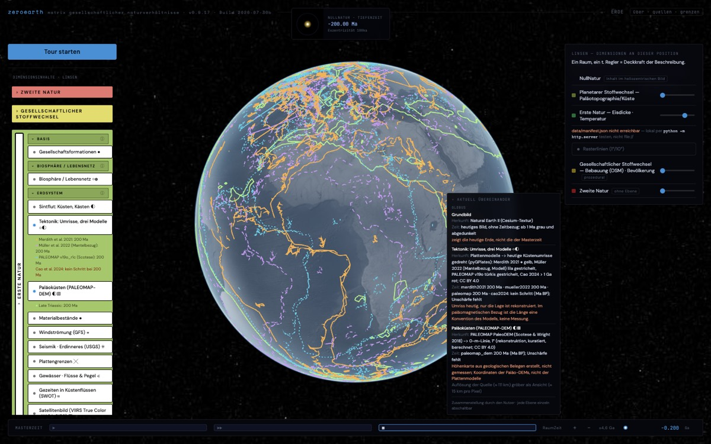
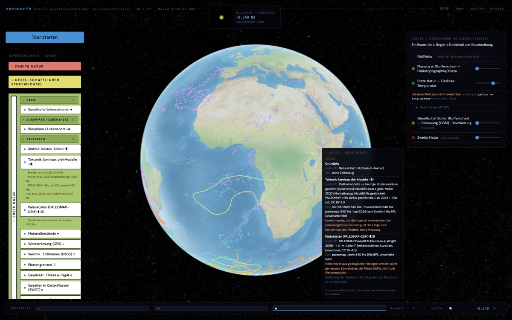
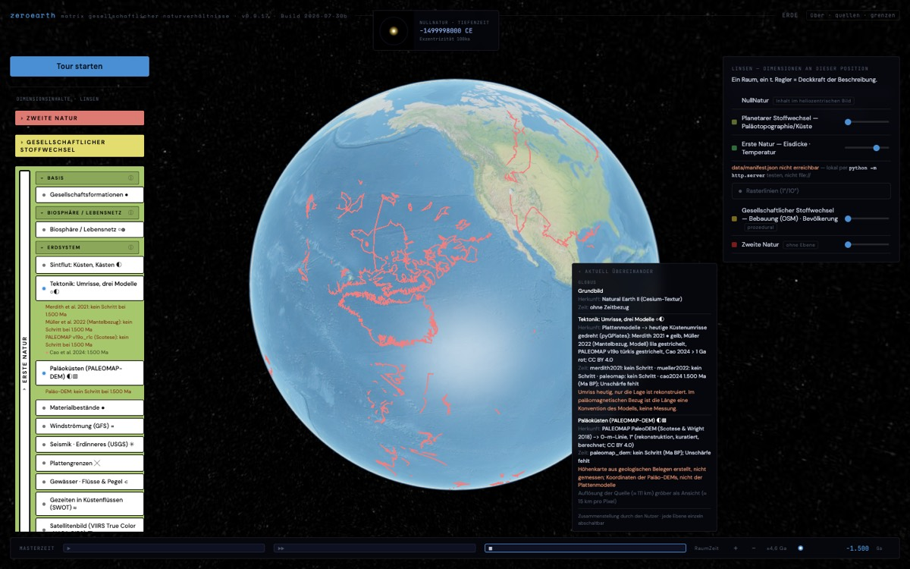

# Bericht: Plattentektonik-Ebene für die Erdzeit

Stand: 2026-11-05. Nur Bericht, nichts gebaut. Daten und Rechnungen lagen im Scratchpad (venv mit pyGPlates 1.0.0, shapely, netCDF4, contourpy); nichts davon ist im Repo.

## Ergebnis in Kürze

- Alle vier geprüften Quellen stehen unter **CC BY 4.0**, laut Lizenzfeld bei Zenodo (abgefragt am 2026-11-05).
- **Längste Abdeckung:** Cao et al. 2024 reicht bis 1,8 Ga, Merdith et al. 2021 bis 1 Ga, PALEOMAP-Paläo-DEMs bis 540 Ma.
- **Dieselbe Linie, nicht zwei Ideale:** Cao 2024 baut auf Merdith 2021 auf. Bis 500 Ma liegen geprüfte Orte in beiden Modellen auf den Kilometer gleich, erst ab 750 Ma weichen sie um rund 1 000 bis 2 600 km ab. Die beiden zählen also nicht als unabhängige Ideale (Regel 13). Unabhängig sind PALEOMAP (Scotese) und, für die absolute Lage, Müller et al. 2022 im Mantelbezug.
- **Falle in pyGPlates:** Fehlt einem Merkmal die Rotation, bleibt es stillschweigend an seiner heutigen Lage. Merdith liefert so bei 1 500 Ma scheinbar Küsten, aber alle 434 gültigen Merkmale haben keine Rotation. Ein Adapter muss `use_identity_for_missing_plate_ids=False` setzen und solche Merkmale als fehlend führen.
- **Größe:** Fertige Linien je Zeitschritt wären rund 30 MB je Modell. Die Geometrie einmal und dazu je Schritt nur die Rotationen ergibt 2,4 MB. Das empfehle ich.

## 1. Quellen

| Quelle | Zeitraum | Auflösung, Schritte | Format | Lizenz | Zitierweise |
| --- | --- | --- | --- | --- | --- |
| **Merdith et al. 2021** (EarthByte), v1.2.4 | 1000–0 Ma | Rotationen an Stützstellen; Küsten- und Kontinentumrisse heutiger Form; Topologien 1000–410, 410–250, 250–0 Ma | GPlates-Projekt (.rot, .gpml/.gpmlz), 8,5 MB | CC BY 4.0 | Merdith, A. S. et al. (2021): Extending full-plate tectonic models into deep time: Linking the Neoproterozoic and the Phanerozoic. Earth-Science Reviews 214, 103477, doi:10.1016/j.earscirev.2020.103477. Daten: doi:10.5281/zenodo.13635864 |
| **Cao et al. 2024**, v2.4 | 1800–0 Ma | wie oben; 1800–1000 Ma eigene Rotationsdatei | GPlates-Projekt, 20,7 MB | CC BY 4.0 | Cao, X., Collins, A. S., Pisarevsky, S., Flament, N., Li, S., Hasterok, D., Müller, R. D. (2024): Earth's tectonic and plate boundary evolution over 1.8 billion years. Geoscience Frontiers 15(6), 101922. Daten: doi:10.5281/zenodo.13628813 |
| **Müller et al. 2022** (Modell SEEM1000), v1.2.2 | 1000–0 Ma | Mantelbezug, optimiert nach tektonischen Regeln; dazu Grids des Ozeanbodenalters | GPlates-Projekt, 12,3 MB; Grids als netCDF | CC BY 4.0 | Müller, R. D. et al. (2022): A tectonic-rules-based mantle reference frame since 1 billion years ago. Solid Earth 13, 1127–1159, doi:10.5194/se-13-1127-2022. Daten: doi:10.5281/zenodo.10910449 (neuere Fassung 1.2.4 angekündigt, nicht geöffnet) |
| **PALEOMAP Paläo-DEMs** (Scotese & Wright 2018) | 540–0 Ma | 1° (auch 0,1°), Schritte von 5 Ma, 109 Karten im 1°-Satz | netCDF (9,3 MB bei 1°, 207 MB bei 0,1°), CSV | CC BY 4.0 (auch `License.txt` im Archiv) | Scotese, C. R., Wright, N. M. (2018): PALEOMAP Paleodigital Elevation Models (PaleoDEMS) for the Phanerozoic. doi:10.5281/zenodo.5460860 |
| **PaleoMAP-Paläoküsten** (Kocsis & Scotese), v7.3 | Phanerozoikum, stufenweise | Shapefiles; Küsten als maximale Transgression, mit Fossilfunden der Paleobiology Database angepasst | Shapefile, 17,5 MB; dazu PALEOMAP-Rotationsmodell | CC BY 4.0 | Kocsis, Á. T., Scotese, C. R. (2021): Mapping paleocoastlines and continental flooding during the Phanerozoic. Earth-Science Reviews, doi:10.1016/j.earscirev.2020.103463. Daten: doi:10.5281/zenodo.7994000 |

**Nicht bestätigt:**
- Ein AGU-Abstract (Scotese 2022) nennt 127 Paläo-DEMs für 0–750 Ma unter doi:10.5281/zenodo.5348492. Der Datensatz dort enthält aber nur die Phanerozoikum-Dateien von 2018.
- Ein 2-Ga-Modell (Li et al. 2023) habe ich nicht gefunden.

## 2. Zwei verschiedene Dinge

| | Rotierte heutige Umrisse | Paläoküsten aus Paläo-DEM |
| --- | --- | --- |
| Was es ist | Heutige Küsten- oder Kontinentlinien, starr mit ihrer Platte gedreht | 0-m-Linie einer rekonstruierten Höhenkarte |
| Was stimmt | die Lage, laut Modell | die Verteilung von Land und Meer, laut Rekonstruktion |
| Was nicht stimmt | die Form: Meere, Gebirge und Schelfe sind von heute | die Feinheit: 1° Gitter; Höhen von Hand gesetzt |
| Zeitraum | 0–1000 Ma (Merdith), 0–1800 Ma (Cao) | 0–540 Ma |
| Pflichthinweis | „Umriss heutig, nur die Lage ist rekonstruiert“ | „Höhenkarte aus geologischen Belegen erstellt, nicht gemessen“ |

Die Paläoküsten von Kocsis & Scotese sind ein drittes Ding: maximale Transgression je Stufe, mit Fossilfunden korrigiert. Sie sind nicht die 0-m-Linie desselben DEM. Wo beide vorliegen, gehören sie nebeneinander (Regel 13).

### Vorschlag zur Herkunft (Regel 6)

| Ebene | Zeitraum | Arten | Angezeigt |
| --- | --- | --- | --- |
| Rotierte Umrisse, Paläomagnetik-Bezug (Merdith, Cao) | 0–1000 Ma | rekonstruktion, berechnet | ◐ |
| dasselbe | 1000–1800 Ma (nur Cao) | rekonstruktion, berechnet; Hinweis: nur Kontinentaldrift, wenige Pole | ◐ |
| Lage im Mantelbezug (Müller 2022) | 0–1000 Ma | modell, berechnet (optimiert nach Regeln) | ○ |
| Synthetische ozeanische Platten und Plattengrenzen | vor etwa 200 Ma | modell, berechnet (aus Regeln erschlossen, Ozeanboden subduziert) | ○ |
| 0-m-Linie aus PALEOMAP-DEM | 0–540 Ma | rekonstruktion, kuratiert, berechnet | ◐ schraffiert |
| Paläoküsten Kocsis & Scotese | Phanerozoikum | rekonstruktion, kuratiert | ◐ schraffiert |

Zwei Dinge gehören in die Ansicht (Regel 7, 10):

- **Längengrad im Paläomagnetik-Bezug:** Paläomagnetik legt nur die Breite fest. Die Länge ist dort eine Konvention des Modells, keine Messung.
- **Wahl des Bezugsrahmens:** Paläomagnetik- oder Mantelbezug ist eine Setzung und steht im Bild.

### Zeit (Regel 16)

Das Schema kennt bisher kein Bezugssystem für Ma. Vorschlag: `ma_bp` mit Einheit Ma und Nullpunkt „heute laut Modell“.
- **Unschärfe:** `{fehlt, grund}`. Keine der Quellen nennt eine Unschärfe der Zeit.
- **Auflösung:** der Abstand der Stützstellen, nur eine Untergrenze.
- **Paläo-DEMs:** Ihre Alter sind Stufenalter einer geologischen Zeitskala; welcher Fassung, wäre vor dem Einbau zu prüfen.

## 3. Ableitung mit pyGPlates: Schritte und Größe

pyGPlates 1.0.0 lässt sich mit pip im Scratchpad-venv installieren (Python 3.9; die Räder decken 3.8 bis 3.13 ab). Gemessen habe ich an den heruntergeladenen Modellen, vereinfacht auf 0,25° und auf 0,1° gerundet.

**Vorschlag für die Schritte, nach Tiefe gestaffelt:**

| Zeitraum | Schritt | Schritte | Begründung |
| --- | --- | --- | --- |
| 1–66 Ma | 1 Ma | 66 | Platten wandern einige Zentimeter im Jahr, also rund 0,5° je Ma; dichte Stützstellen im Känozoikum |
| 70–250 Ma | 5 Ma | 37 | passt zu den PALEOMAP-DEMs |
| 260–1000 Ma | 10 Ma | 75 | |
| 1025–1800 Ma | 25 Ma | 32 | nur Cao; Lage ohnehin grob |

Unter 1 Ma übernimmt PaleoMIST (ka), da sich die Platten kaum bewegen.

**Gemessene Größen:**

| Variante | Merdith 2021 (178 Schritte bis 1000 Ma) | Cao 2024 (210 Schritte bis 1800 Ma) |
| --- | --- | --- |
| A: fertige Linien je Schritt (GeoJSON) | 27,8 MB, gzip 8,0 MB, je Schritt rund 156 KB | 30,9 MB, gzip 8,5 MB, je Schritt rund 147 KB |
| B: Geometrie einmal, je Schritt nur Eulerpol und Winkel je Platte | – | 0,37 MB Geometrie + 2,08 MB Rotationen = 2,4 MB (gzip 0,56 MB); 398 Platten |
| Paläo-DEM, 0-m-Linie auf 1° | 109 Karten 0–540 Ma: 2,1 MB, gzip 0,6 MB, je Karte rund 19 KB | |

**Empfehlung: Variante B.**
- pyGPlates rechnet jede Rotation an jeder Stützstelle. Die Seite wendet nur die fertige Drehung auf die Linien an, ohne Interpolation und ohne eigenes Modell (Regel 12).
- Nur B passt zu „eine Ebene im Bereich weniger Megabyte“ (Strukturstand, Bauform).
- **Datumsgrenze:** In Variante A schneidet pyGPlates die Linien an der Datumsgrenze. In B muss die Seite das selbst tun; Cesium kann das.

**Gültigkeit:** Jedes Merkmal trägt seine Gültigkeitszeit, und eine fehlende Rotation steht als `null` in der Datei, nie als Identität (siehe Falle oben).

**Ideale (Regel 13):**
- Für 0–1000 Ma kommen Merdith und Müller 2022 nebeneinander, dazu für 0–540 Ma PALEOMAP. Mit Variante B sind das drei Rotationssätze auf derselben Geometrie, also wenig mehr Platz.
- Cao ersetzt Merdith nur jenseits von 1000 Ma.
- Erst ab 750 Ma weichen Cao und Merdith ab, gemessen an drei Orten:

| Ort | 750 Ma | 1000 Ma |
| --- | --- | --- |
| Berlin | 2 635 km | keine Rotation in Merdith |
| São Paulo | 0 km | 951 km |
| Perth | 0 km | 1 077 km |

## 4. Was fehlt, und warum

| Zeitraum | Status | Grund |
| --- | --- | --- |
| 540–750 Ma, Paläoküsten | fehlt | Paläo-DEMs für 0–750 Ma sind angekündigt (Scotese 2022), aber im Zenodo-Datensatz nicht gefunden. |
| 1000–1800 Ma | nur ein Modell | Nur Cao 2024 reicht so weit; kein zweites Ideal (Regel 13). Nur Kontinentaldrift mit wenigen paläomagnetischen Polen, Ozeane synthetisch. |
| vor 1800 Ma | fehlt | Kein veröffentlichtes Vollplattenmodell gefunden. |
| ganz ohne Platten | offen | Wann Plattentektonik überhaupt begann, ist umstritten. Die Schätzungen reichen in der Literatur von über 4 bis unter 1 Ga; das habe ich hier nicht eigens belegt. |
| 4,5 bis rund 4 Ga | fehlt | Keine erhaltene Kruste im Zusammenhang, nur einzelne Minerale. |
| Formen vor 540 Ma | fehlt | Nur heutige Umrisse in rekonstruierter Lage, keine Paläoküsten. |

## 5. Skizze: Takt-Leiste von 0 a bis 4,5 Ga

Der Strukturstand verlangt verschachtelte Takte statt einer Achse. Vorschlag: eine Leiste aus Zeilen, jede Zeile ein Takt, und jede Zeile zeigt nur die Umläufe ihres Takts. Ein Klick auf einen Umlauf öffnet darunter die nächste Zeile.

```
Galaktischer Umlauf (rund 230 Ma, Setzung)
|·20·|·19·| … |··3··|··2··|·[1]·|         4,5 Ga ─────────────── heute
                                  ▲ Tektonik: Cao bis Umlauf 8, Merdith bis Umlauf 5
                                  ░ grau: vor 1,8 Ga keine Platten-Daten
  └─ Umlauf 1 (230 Ma bis heute)
     Ma-Zählung in 5-Ma-Strichen, Stützstellen als Punkte
     |••••|••••|••••|•••••••••••••••••|        ● 1-Ma-Schritte im Känozoikum
     ░ zwischen 230 Ma und 405 ka gibt die 0. Natur keinen gut belegten Takt
       vor; die Leiste zählt hier nur in der Richtung (Ma)
       └─ 405-ka-Exzentrizität / 100-ka-Zyklen
          |·8·|·7·| … |·[1]·|                    100 ka bis heute
            └─ Zyklus 1 (100 ka bis heute)
               |• • • • • • • • •|               ● PaleoMIST: 2,5-ka-Schritte
               Sintflut-Fenster 20–0 ka hervorgehoben
```

**Gemeinsam für alle Zeilen:**
- Jede Zeile beschriftet ihr eigenes Maß (Ma, ka), mit Bezugssystem und Unschärfe. `t` bleibt intern.
- Eine Quelle erscheint als Punkte auf den Zeilen, deren Takt zu ihren Schritten passt: Sintflut auf der ka-Zeile, Tektonik auf der Ma-Zeile. Gewählt wird immer eine Stützstelle einer Quelle, nie ein Punkt dazwischen.
- Lücken bleiben grau mit Grund (Regel 8). Der Bereich, in dem eine Quelle schweigt, ist sichtbar.
- Der galaktische Umlauf ist selbst eine Setzung mit Spannweite. Strukturstand nennt rund 230 Ma; die Leiste zeigt das als Annahme (Regel 7).
- **405-ka-Zyklus:** stammt nicht aus dem Strukturstand, sondern ist meine Ergänzung. Die Zahl habe ich hier nicht belegt; das wäre vor dem Bau nachzuholen.
- **Mehrere Quellen:** Wählt man Sintflut und Tektonik zugleich, stehen beide Zeilen offen. Die gewählte Zeit ist dann ein Zeitpunkt je Quelle, kein gemeinsamer Regler.

## Stand des Baus (2026-11-05)

Gebaut nach den Entscheidungen: Variante B, Ideale Merdith 2021, Müller 2022 und PALEOMAP v19o_r1c, Cao 2024 nur jenseits von 1 Ga, Bezugssystem `ma_bp`, Umrisse und Paläoküsten als getrennte Ebenen, Hinweis zum Längengrad.

**Dateien**

| Datei | Inhalt |
| --- | --- |
| `matrix-scharnier/adapter/tektonik.py` | Ableitung mit pyGPlates im Scratchpad-venv |
| `data/tektonik_umrisse.json` | 3,6 MB: Geometrie einmal, je Schritt die Drehung je Platte |
| `data/tektonik_palaeokuesten.json` | 2,1 MB: 109 Karten, 0–540 Ma |
| `kern/adapter/tektonik/` | Manifest, Transform, `drehen.mjs`; die Seite nutzt dasselbe Modul |
| `kern/test/tektonik.test.mjs` | Tests |
| `kern/test/tektonik_stichprobe.json` | 36 von pyGPlates gedrehte Punkte für den Test |

**Prüfung**

- Die Drehung der Seite trifft pyGPlates in allen 36 Punkten auf unter 0,01°.
- Fehlende Drehungen stehen als `null` und werden nicht gezeichnet, nie an heutiger Lage.

**Beim Bau gefunden**

- **Schnittkanten:** Die Küstenpolygone der Modelle sind an Plattengrenzen zerschnitten; ihre Kanten liefen sonst quer über die Kontinente. Behalten werden nur Kanten, die auf dem Rand der heutigen Landmasse liegen (Vereinigung aller Polygone, Band 0,02°).
- **PALEOMAP ohne Küsten:** Das PALEOMAP-Plattenmodell bringt keine Küsten mit. Ich habe die Merdith-Küsten an den PALEOMAP-Plattenpolygonen geteilt; das ist eine Setzung (`tektonik/auswahl/kuesten_paleomap`).
- **Herkunft der Umrisse:** Der Eintrag `tektonik/umrisse` trägt alle beteiligten Arten (rekonstruktion, modell, berechnet), weil Müller 2022 Modell ist (Regel 6). Jede Lage je Ideal trägt ihre eigenen Arten.
- **Grundbild in der Tiefe:** Das heutige Natural-Earth-Bild lag unter den gedrehten Umrissen und las sich leicht als Bild der Zeit.
  - Gebaut: Ab 1 Ma vor heute werden Grundbild, Satellitenbild und Nachtlichter grau und auf 35 % Helligkeit gedunkelt; die Legende sagt dann „zeigt die heutige Erde, nicht die der Masterzeit“.
  - Warum 1 Ma: Platten wandern rund 0,5° je Ma, mehr als die 0,25° der Umrisse.
  - Abgeschaltet wird nichts: Das Bild bleibt Orientierung im heutigen Gradnetz.
  - Unter 1 Ma, also auch bei der Sintflut, bleibt es farbig; dort steht weiter „ohne Zeitbezug“.






## Zeitgrenzen je Quelle (für eine Küsten- und Höhenreihe über die Erdzeit)

Ziel ist eine Reihe aus mehreren Quellen, jede in ihrem Zeitraum: Nähte bleiben sichtbar, Überlappungen stehen nebeneinander (Regel 13), nichts wird verschmolzen.

| Quelle | Zeitraum | Schritte | Raum | Bezugssystem | Was es ist | Lizenz |
| --- | --- | --- | --- | --- | --- | --- |
| GEBCO_2025 | heute (Stand 2025) | eine Fassung | 15″ | a CE | Höhen und Tiefen, gemessen und aus Schwere abgeleitet; ein Typ-Gitter (TID) nennt die Quelle je Zelle | gemeinfrei, mit Bedingungen (keine amtliche Billigung vortäuschen) |
| PaleoMIST 1.0 (im Repo) | 80–0 ka | 2,5 ka, 33 Schritte | 0,25° (Küsten), 1° (Eis) | ka BP, Bezugsjahr 1950 | Paläotopographie mit Eis und Deformation | CC BY 4.0 |
| PALEOMAP PaleoDEM | 540–0 Ma | 5 Ma, 109 Karten | 1° (auch 0,1°) | Ma BP | Höhenkarte aus geologischen Belegen | CC BY 4.0 |
| Kocsis & Scotese, Paläoküsten v7 | 535–0 Ma | 81 Karten, Abstand 5 bis 15 Ma | Vektor | Ma BP | Küste der maximalen Transgression je Stufe, mit Fossilfunden korrigiert | CC BY 4.0 |
| Merdith 2021, Müller 2022, PALEOMAP (Platten) | 1000–0 Ma | 1/5/10 Ma (eigene Wahl) | Linien 0,25° | Ma BP | heutige Umrisse in rekonstruierter Lage | CC BY 4.0 |
| Cao 2024 | 1800–1025 Ma | 25 Ma (eigene Wahl) | Linien 0,25° | Ma BP | wie oben, nur Kontinentaldrift | CC BY 4.0 |

**Nähte, die sichtbar bleiben müssen**

- **Bei 0, viermal „heute“:** GEBCO 2025 (a CE), PaleoMIST 0 ka (Bezugsjahr 1950), PALEOMAP „Holocene 0 Ma“, Plattenmodelle 0 Ma („heute laut Modell“). Drei Bezugssysteme, Unschärfe überall fehlend. Nach Regel 16 lässt sich Gleichzeitigkeit nicht prüfen; die vier stehen nebeneinander.
- **Bei 80 ka:** PaleoMIST endet.
- **Bei 540 Ma:** Paläoküsten (DEM) enden; Kocsis & Scotese schon bei 535 Ma.
- **Bei 1000 Ma:** Wechsel von Merdith zu Cao. Hier springt die Lage: An drei geprüften Orten liegen die beiden Modelle bei 1000 Ma 951 km (São Paulo) und 1 077 km (Perth) auseinander; Berlin hat bei Merdith dort keine Drehung. Die Leiste und die Legende müssen den Wechsel zeigen.
- **Innerhalb des Phanerozoikums:** DEM-0-m-Linie und Kocsis-Küste sind zwei verschiedene Dinge (Momentaufnahme gegen maximale Transgression). Nebeneinander, nie gemittelt.

**Die Lücke zwischen PaleoMIST (ka) und PALEOMAP (Ma)**

- PALEOMAP hat nach der Karte bei 0 Ma die nächste erst bei 5 Ma (Pliozän).
- PaleoMIST reicht nur bis 80 ka.
- Von 80 ka bis 5 Ma gibt es in den geprüften Quellen **keine Küste und keine Höhe**. Das ist das ganze übrige Quartär mit seinen Eiszeitzyklen, in denen sich die Küsten auf den Schelfen immer wieder verschoben. Mit 5-Ma-Schritten verschwinden sie ganz.
- **Status:** `fehlt`, Grund: „Keine geprüfte Quelle für Küsten oder Höhen zwischen 80 ka und 5 Ma; PALEOMAP hat 5-Ma-Schritte, PaleoMIST endet bei 80 ka.“

**Kandidaten, noch nicht geprüft oder nur teilweise:**

| Kandidat | Was es ist | Stand der Prüfung |
| --- | --- | --- |
| PRISM4 (Dowsett et al. 2016) | Paläogeographie des mittleren Piacenziums, rund 3 Ma, mit isostatischer Anpassung und dynamischer Topographie | Der USGS-Datensatz doi:10.5066/P9NF43WW ist als CC0 ausgewiesen, NetCDF. Ob eine Topographie-Datei enthalten ist, ist nicht geprüft. Nur eine Zeitscheibe. |
| Batchelor et al. 2019 | Ausdehnung der nordhemisphärischen Eisschilde in 17 Zeitscheiben des Quartärs | Artikel CC BY 4.0. Ein Download der Shapefiles ist nicht bestätigt, nur ein ArcGIS-Dienst. Eis, keine Küsten. |
| Meeresspiegelkurven, etwa Spratt & Lisiecki 2016 | eindimensionale Kurven | Küsten daraus zu rechnen (Kurve auf heutige Bathymetrie) wäre eigene Modellierung (Regel 12); nur als ausgewiesene Ausnahme. |

**Vorschlag für die Reihe:** je Quelle eine eigene Ebene mit eigenem Zeichen und Zeitraum. Die Takt-Leiste zeigt ihre Abdeckungen als Bänder untereinander, die Lücke 80 ka bis 5 Ma grau mit Grund.

## Offen für eine Entscheidung

Punkte 1 bis 4 aus dem ersten Bericht sind entschieden und gebaut (siehe Stand des Baus). Neu offen:

1. Grundbild in der Tiefe: entschieden (Max, 2026-11-05): Abdunkeln ab 1 Ma bleibt.
2. Kocsis & Scotese als dritte Küstenebene neben der DEM-0-m-Linie?
3. Lücke 80 ka bis 5 Ma: PRISM4 als einzelne Zeitscheibe prüfen?
4. GEBCO als „heute“-Ebene: welcher Ausschnitt und welche Vergröberung?

## Quellen (abgerufen 2026-11-05)

- [EarthByte: Merdith et al. 2021](https://www.earthbyte.org/extending-full-plate-tectonic-models-into-deep-time-linking-the-neoproterozoic-and-the-phanerozoic/), [Zenodo 13635864](https://zenodo.org/records/13635864)
- [EarthByte: Cao et al. 2024](https://www.earthbyte.org/geoscience-frontiers-earths-tectonic-and-plate-boundary-evolution-over-1-8-billion-years/), [Zenodo 13628813](https://zenodo.org/records/13628813)
- [Solid Earth: Müller et al. 2022](https://se.copernicus.org/articles/13/1127/2022/), [Zenodo 10910449](https://zenodo.org/records/10910449)
- [EarthByte: PaleoDEM Scotese & Wright 2018](https://www.earthbyte.org/paleodem-resource-scotese-and-wright-2018/), [Zenodo 5460860](https://zenodo.org/records/5460860)
- [Zenodo 7994000: PaleoMAP-Paläoküsten](https://zenodo.org/record/7994000)
- [AGU 2022: PaleoDEMs 0–750 Ma (Abstract)](https://ui.adsabs.harvard.edu/abs/2022AGUFMGP45B0277S)
- [pyGPlates: Erste Schritte](https://www.gplates.org/docs/pygplates/pygplates_getting_started), [pyGPlates 1.0.0](https://www.gplates.org/news/2025-03-27-PyGPlates-1-0-0-released/)
- [Zenodo 13636799: Müller et al. 2022, v1.2.4](https://zenodo.org/records/13636799)
- [GEBCO_2025 Grid](https://www.gebco.net/data-products-gridded-bathymetry-data/gebco2025-grid), [Nutzungsbedingungen](https://www.gebco.net/data-products/gridded-bathymetry/terms-of-use)
- [PRISM4 (Climate of the Past 2016)](https://cp.copernicus.org/articles/12/1519/2016/), [USGS-Datensatz](https://www.usgs.gov/data/prism4-mid-piacenzian-paleoenvironmental-reconstruction-data)
- [Batchelor et al. 2019 (PMC)](https://pmc.ncbi.nlm.nih.gov/articles/PMC6697730)
