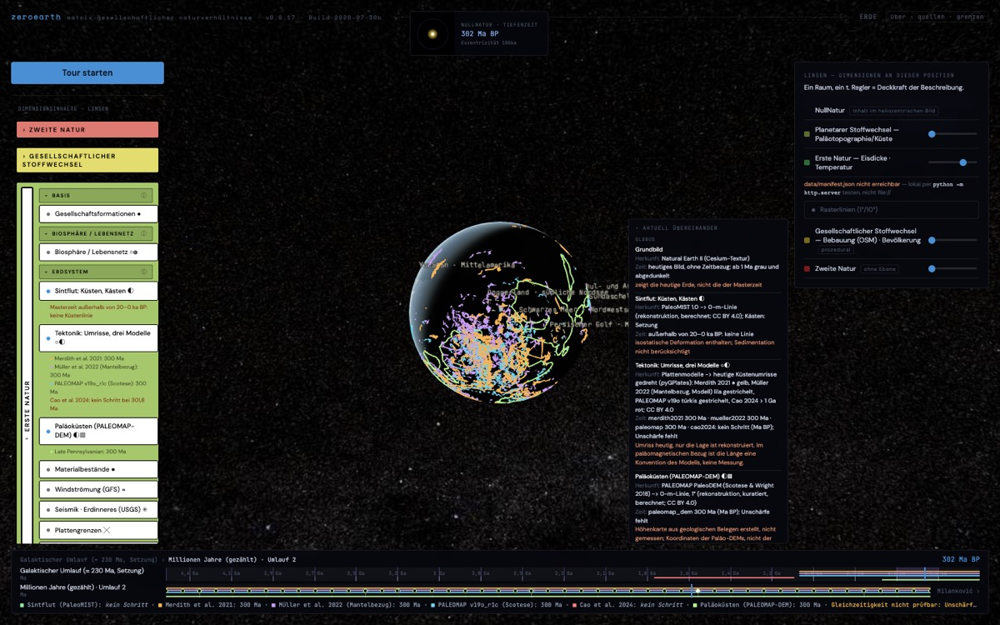
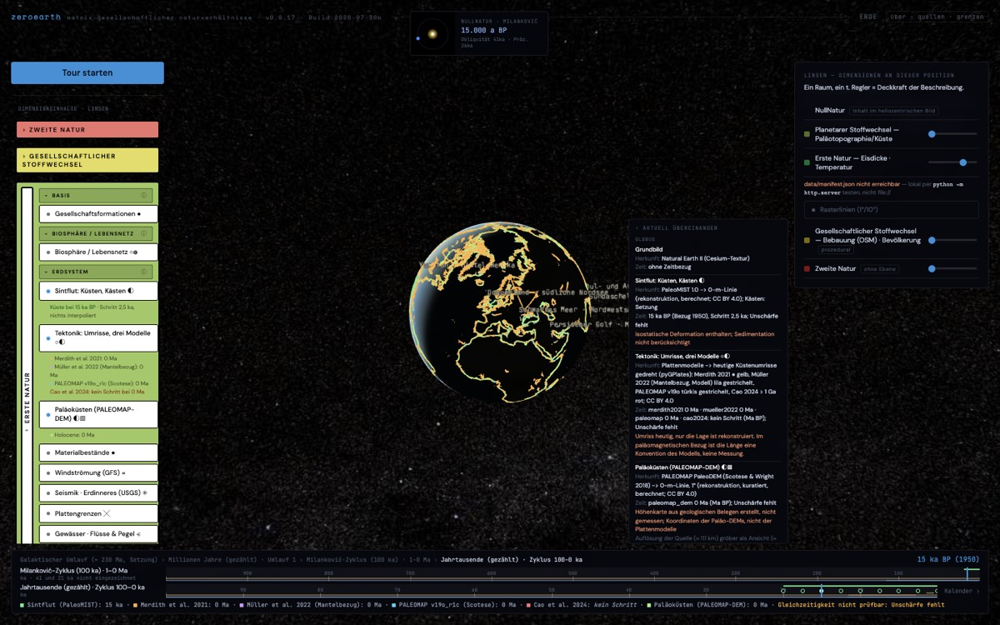
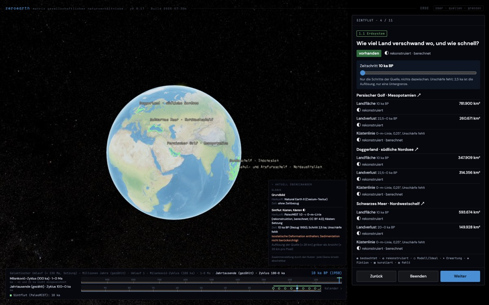

# Plan: Takt-Leiste

Stand: 2026-11-05. Gebaut am selben Tag, siehe „Stand des Baus“ am Ende. Grundlage: Strukturstand, Abschnitt Zeit („keine einzelne Achse“, „verschachtelte Takte“), Regel 16 und die Skizze in `kern/BERICHT-tektonik.md`, Abschnitt 5.

## Was sie ersetzt

Die heutige Masterzeit (`#tl`) zeigt eine einzige Achse über `t` (Jahre seit J2000), mit Zoomstufen von ±18 Tagen bis ±4,6 Ga. Das widerspricht Entscheidung 3 (`t` nie als einzelne Achse). Sichtbar wird es zum Beispiel im Mini-Fenster oben, das bei 1,5 Ga „-1499998000 CE“ anzeigt. `t` bleibt als interne Rechengröße, für die Ebenen, die ihren Schritt daraus wählen.

## Aufbau

Mehrere Zeilen übereinander. Jede Zeile ist ein Takt mit eigenem Maß:

| Zeile | Takt | Maß | Woher |
| --- | --- | --- | --- |
| 1 | galaktischer Umlauf, rund 230 Ma | Ma | Strukturstand; Setzung mit Spannweite, als Annahme beschriftet |
| 2 | Ma-Zählung (Richtung) | Ma | kein Takt der 0. Natur in diesem Bereich; nur gezählt |
| 3 | Milanković, 100 ka (41, 21 ka als Unterteilung) | ka | Strukturstand |
| 4 | Jahr | a | Erdumlauf |
| 5 | Tag, Monat | d | Erdrotation, Mond |

- **Öffnen:** Ein Klick auf einen Umlauf öffnet die nächste Zeile für genau diesen Umlauf, wie ein Brotkrumenpfad: „4,5 Ga › Umlauf 1 › 100-ka-Zyklus 1 …“.
- **Zeilen sind Daten, nicht Code:** eine Datei `kern/takte.json` mit Name, Periode, Spannweite, Quelle und Status je Takt. Was dort fehlt, steht grau mit Grund (Regel 8). Das gilt etwa für den 405-ka-Zyklus, solange er nicht belegt ist.

## Quellen auf der Leiste

- Jede Ebene, die eine Zeitreihe zeigt, meldet ihre Stützstellen. Sie kommen aus den Dateien: `schritte_ma`, `ka_bp`, `karten[].ma`.
- Die Stützstellen erscheinen als Punkte auf der Zeile, deren Maß zu ihnen passt: Sintflut (2,5 ka) auf Zeile 3, Tektonik (1 bis 25 Ma) und Paläoküsten (5 Ma) auf Zeile 2.
- Abdeckung wird als Band gezeichnet, Lücken grau mit dem Grund aus dem Manifest. Beispiele: vor 1,8 Ga keine Plattenmodelle, zwischen 80 ka und 5 Ma keine Küsten (siehe `kern/BERICHT-tektonik.md`, Zeitgrenzen).
- Gewählt wird immer eine Stützstelle einer Quelle, nie ein Punkt dazwischen.
- Sind mehrere Quellen an, trägt jede ihren eigenen Zeitpunkt in ihrem eigenen Bezugssystem. Gemeinsam ist nur die gewählte Zeile, kein gemeinsamer Regler.
- **Gleichzeitig (Regel 16):** Zwei Quellen gelten als gleichzeitig nur, wenn sich ihre Zeiträume mit Unschärfe überlappen. Fehlt die Unschärfe, zeigt die Leiste „Gleichzeitigkeit nicht prüfbar“ statt eines Häkchens.

## Anzeige

- Jede Zeile beschriftet ihr Maß mit Bezugssystem (ka BP 1950, Ma BP, a CE) und Unschärfe.
- Die gewählten Zeitpunkte stehen in der Legende „aktuell übereinander“, je Quelle, wie heute bei Sintflut und Tektonik.
- Echtzeit, Raffer und Pause bleiben, aber nur auf den Zeilen Jahr und Tag; in der Tiefe gibt es keine laufende Uhr.

## Schritte zum Bau

1. `kern/takte.json` mit Schema und Prüfung: Periode mit Spannweite oder `{fehlt, grund}`, Quelle Pflicht.
2. Schnittstelle der Ebenen: `stuetzstellen()` gibt `{bezugssystem, werte, abdeckung, luecken}` zurück; Sintflut, Tektonik und Paläoküsten zuerst.
3. Leiste als eigenes Bauteil anstelle von `#tl`. `Tideline` bleibt als interne Uhr dahinter, wird aber nicht mehr direkt angezeigt.
4. Touren setzen statt `Tideline.zoom` die Zeile und die Stützstelle.
5. Tests: Kern prüft `takte.json`; im Browser prüfen, dass jede Stützstelle wählbar ist und kein Wert dazwischen.

## Offen

- **Nicht belegte Zahlen:** Spannweite des galaktischen Umlaufs und der 405-ka-Zyklus brauchen eine Quelle, bevor sie Zeilen werden.
- **Schwache Takte 1 a bis 21 ka:** Wie die Lücke zwischen 1 a und 21 ka gezeigt wird (Strukturstand: dort setzt die 2. Natur eigene Takte). Vorschlag: eine eigene Zeile „Kalender“, als 2. Natur gekennzeichnet.
- **Kleine Bildschirme:** Sie zeigen höchstens zwei Zeilen zugleich.

## Stand des Baus (2026-11-05)

**Gebaut**

- **Takte als Daten:** `kern/takte.json` mit `pruefeTakte` (Regel T) und `kern/test/takte.test.mjs`. Die Seite liest die Kopie `data/takte.json`; ein Test hält beide gleich.
- **Was fehlt, steht mit Grund in `fehlend`:** der 405-ka-Zyklus und die Kalenderzeile der 2. Natur. Die Prüfung meldet beide als Hinweis.
- **Leiste:** Sie ersetzt die Masterzeit (die alte bleibt verborgen im DOM, weil andere Teile ihre Elemente noch beschreiben).
  - Zeilen: galaktischer Umlauf (Setzung 230 Ma), Ma gezählt, Milanković 100 ka, ka gezählt, Jahr (a CE).
  - Sichtbar sind die Brotkrumen und die zwei innersten Zeilen. Ein Klick setzt die Zeit und öffnet die nächste Zeile; „… ›“ öffnet sie ohne Zeitwechsel.
- **Quellen auf der Leiste:**
  - Sintflut, Tektonik und Paläoküsten melden `stuetzstellen()`.
  - Punkte stehen nur in der Zeile ihres Maßes (Ma oder ka), anderswo nur die Abdeckung als Band. Ein Punkt wählt genau diese Stützstelle.
  - Unten steht je Quelle der gewählte Schritt oder „kein Schritt“. Bei mehreren Quellen erscheint „Gleichzeitigkeit nicht prüfbar: Unschärfe fehlt“ (Regel 16).
- **Epochen:** Die ZeitRäume (`PERIODS`) liegen als dünne Bänder in den Zeilen, in deren Bereich sie fallen.
- **Uhr und Mini-Fenster:** Echtzeit, Raffer und Pause sitzen nur in der Jahr-Zeile. Das Mini-Fenster zeigt die Tiefe im Maß der Leiste (statt „-1499998000 CE“).
- **Touren:** Die Sintflut-Tour öffnet die ka-Zeile, und der Zeitschritt-Regler bewegt den Punkt mit.

**Nicht gebaut**

- 41 und 21 ka sind als Unterteilung genannt, aber nicht eingezeichnet.
- Die Kalenderzeile der 2. Natur fehlt.
- `Tideline.zoom` wird aus der Tiefe nachgeführt, damit Register und Hash weiter stimmen; ein eigener Hash-Eintrag für die Tiefe fehlt.
- Auf schmalen Bildschirmen ist die Leiste nicht geprüft.

## Bildschirmfotos

